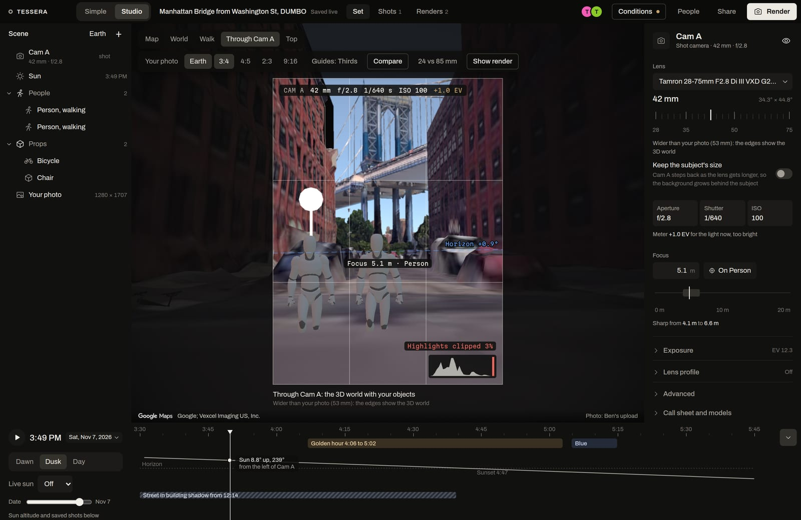

# Tessera

Stand where the photo was taken, then make the shot yours. Drop a photo of a place and Tessera finds where the photographer stood, which way they faced and what lens they used, rebuilds the place as a 3D set, and your group plans its own version there together: in a browser, in a Telegram chat or by phone. Built at HackUTD 2026, where it won 2nd place in the Spacetime track.



- **Try it:** the demo shoot at the Manhattan Bridge view in DUMBO, in [Simple](https://app.tesseraphoto.com/p/A9TVAN) or in [Studio](https://app.tesseraphoto.com/studio/A9TVAN)
- **Site and docs:** https://tesseraphoto.com
- **Track pages:** [NVIDIA](https://tesseraphoto.com/tracks/nvidia/), [SpacetimeDB](https://tesseraphoto.com/tracks/spacetime/), [Photon](https://tesseraphoto.com/tracks/photon/), [Vultr](https://tesseraphoto.com/tracks/vultr/), [Virality](https://tesseraphoto.com/tracks/virality/) (our HackUTD track)

## Videos

- Main video (2:10): https://youtu.be/KxeUG-_GlKs (the earlier 2:57 cut: https://youtu.be/SvSqGH4IKKk) (the 1:35 cut: https://youtu.be/TBKutDiVhSI)
- NVIDIA (2:38, every Nemotron use): https://tesseraphoto.com/videos/tessera-nvidia.mp4, and a 1:14 cut: https://youtu.be/-thSL8iYLlU
- SpacetimeDB (1:10): https://youtu.be/CyivsP2lXpc
- Photon (1:09): https://tesseraphoto.com/videos/tessera-photon.mp4
- Vultr (0:59): https://youtu.be/fsq3ry87EZ8
- Ten vertical reels for the Virality track: https://tesseraphoto.com/reels/

## The problem

A photo shows you a place, not where to stand. Google Lens names the landmark in a second; the standing spot, the direction and the zoom are still guesswork. People ask strangers online, message photographers who often won't say, or walk around until it lines up, and a phone on 1x still gets a different picture when the original used a longer lens. The research behind this, with sources, is in [PROBLEM.md](PROBLEM.md).

## What it does

1. **Drop a photo.** Nemotron Content Safety screens it, the spot comes from its GPS or a name, and the solver matches it against our own 3D model of the spot. On 11 held-out photos from other photographers, 10 were placed, 9 of them within 25 m of their phone GPS, with a median focal length error of 3% and a median solve of 15.8 s on a CPU. The 11th had 75 matches and got "Couldn't place" instead of a guess ([spots/nyc_dumbo/eval.md](spots/nyc_dumbo/eval.md)).
2. **Found it.** Where to stand, which way to face (4° N on the demo), the lens as "2.2x on your iPhone's main camera" with the 35 mm equivalent, how sure it is (Solid, Check this, Couldn't place) and the next good light. The photo blends over the 3D view so you can check the answer yourself.
3. **Make it yours.** The place becomes a 3D set: people, props, lights and a camera with real bodies and lenses. Describe a change in words and Nemotron places it. Move the sun to golden hour. Render, and your objects land in your own photo, labelled "AI interpretation".
4. **Take me there.** The scout page walks you to the mark with the original photo as a ghost over your camera, while friends watch your dot move.

In Through Cam A, the backplate behind your objects is your photo, Google's 3D Earth (the default) or Street View when Google has a panorama within about 15 m of the camera. Street View carries Google's credit and the capture date and is display only: it never enters a render or a model.

Two examples on the start page: **Try Manhattan Bridge from Washington St** (solved against our DUMBO model) and **Try Empire State Building from Top of the Rock** (photo by Daniel Schwen, CC BY-SA 4.0; a fresh shoot placed on the deck at 259 m, facing 205° at 65 mm). Shared demo shoots: [A9TVAN](https://app.tesseraphoto.com/p/A9TVAN) (DUMBO) and [7PL6L6](https://app.tesseraphoto.com/p/7PL6L6) (Top of the Rock); details in [docs/DEMO-SHOOTS.md](docs/DEMO-SHOOTS.md).

Two views edit the same live set: **Simple** (`/p/<code>`), phone first, and **Studio** (`/studio/<code>`), the set editor for photographers. The 3D world is Google Photorealistic 3D Tiles (display only) plus our clay model of the block with the user's photo projected onto it.

## How it works

```
 Simple and Studio (browser)    scout page (phone)        Telegram, iMessage, SMS, email, phone
           |                          |                                 |
           |  websocket (SpacetimeDB TypeScript SDK)                    |  Photon 2.0 API
           v                          v                                 v
 +-----------------------------------------------+    websocket    +---------------------------------------+
 | SpacetimeDB module `shotmatch`, Maincloud     |<--------------->| crew (Node), Vultr VM, :8790          |
 | every set object, job, version and message    |                 | serves web/dist behind Caddy (HTTPS)  |
 | is a row; schedules, views, HTTP routes       |                 | agent loop, renders, Photon bridge    |
 +----------------------+------------------------+                 +------+-----------------+--------------+
                        | inter-database calls                            | HTTP             | HTTP (ssh tunnel)
                        v                                                 v                  v
 +-----------------------------------------------+           solver (Python, FastAPI)   lens model (vLLM,
 | library database `shotmatch-library`          |           same VM, :8791             Nemotron Nano VL + LoRA)
 | shared props and finished shots               |                                      Brev A100, :8000
 +-----------------------------------------------+
```

| Piece | Runs on | Address |
|---|---|---|
| SpacetimeDB module `shotmatch` ([module/src/index.ts](module/src/index.ts)) | Maincloud | `wss://maincloud.spacetimedb.com` |
| Library database `shotmatch-library` ([module/library/src/index.ts](module/library/src/index.ts)) | Maincloud | inter-database calls from the module only |
| crew ([crew/](crew/)) | Vultr VM `shotmatch-app`, Dallas | `127.0.0.1:8790`, public through Caddy at https://app.tesseraphoto.com |
| web ([web/](web/)) | built to `web/dist`, served by the crew | Vite dev server `5173`, proxies `/api`, `/photo`, `/preview` to `8790` |
| solver ([solver/](solver/)) | same VM | `127.0.0.1:8791`, never public |
| lens model ([lens/](lens/)) | Brev A100 (vLLM) | `:8000`, reached through an ssh tunnel on the VM at `127.0.0.1:18000` (`LENS_URL`) |
| Ollama with Nemotron 3.5 Bolt | same VM | `127.0.0.1:11434`, the offline command parser |
| site ([site/](site/)) | same VM, Caddy | https://tesseraphoto.com |

The HTTP contracts between the pieces are in [CONTRACTS.md](CONTRACTS.md); the full reference is on the site under Docs.

## Sponsor tracks

### NVIDIA: Nemotron, beyond a chatbot

Nemotron does the work between your words and the set as tool-calling workflows, and every step is a row the studio shows live: text to set (16 objects from one sentence in 6.6 s), rebuilding the photo's people and cars as stand-ins, a render that checks its own physics, props from words or photos at real size, an art director, a call sheet with a cuOpt route, voice with Parakeet and Magpie, an offline path with Bolt on the VM's CPU, and Content Safety on every input. Our own LoRA fine-tune of Nemotron Nano 12B v2 VL reads the lens of any photo: 72.4% long-lens recall on landmarks it never saw ([lens/RESULTS.md](lens/RESULTS.md)).

- Model ids and endpoints: [crew/src/config.ts](crew/src/config.ts), [crew/src/models.ts](crew/src/models.ts), live ledger in [crew/src/catalog.ts](crew/src/catalog.ts)
- Text to set: [crew/src/setagent.ts](crew/src/setagent.ts), [crew/src/settools.ts](crew/src/settools.ts), [crew/src/setgeo.ts](crew/src/setgeo.ts)
- Photo and light reads: [crew/src/vision.ts](crew/src/vision.ts)
- Render and physics check: [crew/src/render.ts](crew/src/render.ts), [crew/src/composite.ts](crew/src/composite.ts)
- Props at real size: [crew/src/gen.ts](crew/src/gen.ts), [crew/src/props3d.ts](crew/src/props3d.ts)
- Voice: [crew/src/speech.ts](crew/src/speech.ts); search: [crew/src/search.ts](crew/src/search.ts), [crew/src/similar.ts](crew/src/similar.ts); shoot day: [crew/src/shootday.ts](crew/src/shootday.ts)
- Studio panels: [web/src/nvidia/](web/src/nvidia/)
- Lens fine-tune: [lens/train.py](lens/train.py), [lens/eval.py](lens/eval.py), [lens/serve.sh](lens/serve.sh)
- Nemotron called from inside the database: `titleSession` in [module/src/index.ts](module/src/index.ts)
- Write-up: [docs/NVIDIA.md](docs/NVIDIA.md); page: [/tracks/nvidia/](https://tesseraphoto.com/tracks/nvidia/)

### SpacetimeDB: it powers the primary function

The product is a shared set, and SpacetimeDB is its only backend. There is no server, websocket layer, queue or cron of ours between the browsers, the scout's phone, the crew and the chat bridge; they all read and write the same rows in one TypeScript module.

- **The set is rows.** Every person, prop, light and camera is a row in `scene_object` ([module/src/index.ts](module/src/index.ts)). A Studio drag calls `lockSceneObject` and `updateSceneObject` ([web/src/studio/state/useScene.ts](web/src/studio/state/useScene.ts)), and every other client gets the change from its subscription ([web/src/spacetime/hooks.ts](web/src/spacetime/hooks.ts)).
- **Solving a photo is a job row.** The crew claims `solve_job` rows with `claimJob`, renews them with `reportProgress` and ends them with `finishJob` ([crew/src/jobs.ts](crew/src/jobs.ts)); the module's 10 s `sweep` schedule requeues a job whose worker stopped.
- **Private by default.** Row-level security delivers a session's rows only to its members (`session_member`).
- **Also in the module:** scene history with undo and restore by anyone, text threads as a version tree (`restoreToVersion`), event tables for cursors and laser pings (`sendSetEvent`), schedules for presence, the live sun and golden-hour reminders, a procedure that calls Nemotron, HTTP routes (health, share links, the phone agent's signed webhook), and inter-database calls to the library.
- **Proof:** [module/scripts/proof.ts](module/scripts/proof.ts) (feature checks with two users and a crew) and [module/scripts/loadtest.ts](module/scripts/loadtest.ts) (3 clients at 10 Hz for 30 s: 900 of 900 edits committed, median round trip 42 to 50 ms).
- Write-up with line references: [docs/SPACETIME.md](docs/SPACETIME.md); page: [/tracks/spacetime/](https://tesseraphoto.com/tracks/spacetime/)

### Photon: the set in your texts

Most people on a shoot will never open a 3D editor, so the set comes to the app they already use. Live on Telegram through @ShotMatchSetBot: 9 round trips recorded on Nov 8 between 12:42 and 1:24 AM CT (a hello, locate a photo, an edit returned as v1, a reply that forked v1.1, the version list, a photo check-in, a texted prop, a studio render fanned out as an album, and a golden-hour alert fired by the database schedule). iMessage, SMS, voice, email and WhatsApp are built and proven end to end against a stand-in for the Photon Beta API (29 of 29 checks); they need numbers and DNS set up in Photon's dashboard.

- Event stream and router: [crew/src/photon.ts](crew/src/photon.ts)
- Channels (formats, fan-out, invites, versions, check-ins, alerts): [crew/src/channels/](crew/src/channels/)
- The phone call's tools: [crew/src/voice.ts](crew/src/voice.ts)
- Studio panel: [web/src/photon/](web/src/photon/)
- End-to-end run and the stand-in: [crew/scripts/photon-e2e.ts](crew/scripts/photon-e2e.ts), [crew/test/fake-photon.ts](crew/test/fake-photon.ts)
- Write-up: [docs/PHOTON.md](docs/PHOTON.md); page: [/tracks/photon/](https://tesseraphoto.com/tracks/photon/)

### Vultr

Production runs on one Vultr VM in Dallas (12 vCPU, 24 GB): Caddy with automatic HTTPS for the app and the site, the crew, the solver and Ollama. Vultr Object Storage keeps photos, renders and generated props. Vultr Serverless Inference runs Nemotron Content Safety (the primary safety path), Nemotron 3 Nano Omni, Qwen-Image 2.1 and Whisper.

- VM services and deploys: [ops/](ops/) (`Caddyfile`, `deploy-vultr.sh`, `deploy-site.sh`, `shotmatch-*.service`, `ollama.sh`)
- Object Storage client: [crew/src/s3.ts](crew/src/s3.ts)
- Serverless Inference calls: `VULTR_INFERENCE_BASE` in [crew/src/config.ts](crew/src/config.ts), used in [crew/src/models.ts](crew/src/models.ts) and [crew/src/speech.ts](crew/src/speech.ts)
- Page: [/tracks/vultr/](https://tesseraphoto.com/tracks/vultr/)

## Run it locally

You need Node 22, Python 3.12, the SpacetimeDB CLI 2.14.1 (`spacetime login`), and a Google Maps Platform key with the Map Tiles API.

**Secrets** live in `~/.config/shotmatch/`, one value per file, mode 600, never committed. Every feature whose key is missing switches off and says so.

| File | Used for |
|---|---|
| `maps_key` | Google Photorealistic 3D Tiles in the browser (the only secret sent to the browser) |
| `nvidia_key` | NVIDIA API Catalog models, and the module's title procedure |
| `vultr_inference_key`, `vultr_s3` | Vultr Serverless Inference; Object Storage (`endpoint`, `bucket`, `access_key`, `secret_key` lines) |
| `crew_code`, `crew_token` | the one-time code that makes the crew the module's worker, and the crew's SpacetimeDB identity |
| `photon_api_key`, `photon_project_id`, `photon_agents` | Photon |
| `elevenlabs_key`, `elevenlabs_webhook_secret`, `voice_tool_secret` | the phone call and its signed webhook |
| `openai_key`, `gemini_key` | fallbacks named in the results when they run |

```sh
# SpacetimeDB module: publish to a database you own, then generate bindings for web, crew and scripts
cd module && npm ci
spacetime publish --server maincloud <your-db> -y     # or `npm run publish:env` for `shotmatch` with its env from ~/.config/shotmatch
npm run generate

# Solver: Python venv, then the FastAPI server on 127.0.0.1:8791
cd solver && ./setup.sh && .venv/bin/python server.py

# Crew on 127.0.0.1:8790 (DB_NAME and SPACETIME_HOST override the database)
cd crew && npm ci && DB_NAME=<your-db> npm start

# Web on http://localhost:5173
cd web && npm ci && npm run dev
```

The spot's photos and its 3D model are not in the repo. Each training photo is listed with its Commons page in [spots/nyc_dumbo/CREDITS.tsv](spots/nyc_dumbo/CREDITS.tsv); download them into `spots/nyc_dumbo/images/` and build with `solver/build_spot.py` ([solver/README.md](solver/README.md)).

**Tests**

```sh
cd crew && npm test                          # 75 tests: formats, geometry, the version tree, the Photon client, compositing
cd web && npm run build                      # type check and build
cd web && node src/studio/optics.check.ts    # depth of field, exposure and the sun against hand-worked values
cd solver && .venv/bin/python test_geometry.py
cd module && npm run check                   # HMAC used by the webhook, against node:crypto
```

## Repo layout

| Folder | What |
|---|---|
| [crew/](crew/) | Node worker: claims jobs, runs the Nemotron workflows, renders, bridges Photon, stores photos |
| [web/](web/) | Simple, Studio and the scout page, one Vite and React app with three.js |
| [module/](module/) | the SpacetimeDB module, the library database, proof and load-test scripts |
| [solver/](solver/) | spot builds and photo localization (pycolmap, hloc, MegaLoc, SuperPoint, LightGlue) |
| [lens/](lens/) | the lens dataset pull, LoRA fine-tune, evaluation and vLLM serving |
| [spots/](spots/) | one folder per mapped spot: manifest, credits, evaluation, street geometry |
| [ops/](ops/) | Caddy, systemd units and deploy scripts for the Vultr VM |
| [site/](site/) | the site and docs (Astro and Starlight) |
| [docs/](docs/) | write-ups per sponsor, the story bible and the track list |
| [design/](design/) | design briefs and the Figma exports |
| [splat/](splat/) | scripts from an experiment that did not ship (see Known limits) |

[BUILD.md](BUILD.md) is the build plan and log, [CONTRACTS.md](CONTRACTS.md) the interfaces between pieces, [PROBLEM.md](PROBLEM.md) the research, [DEVPOST.md](DEVPOST.md) the submission text.

## Credits and licences

Tessera is built from other people's work; the full list is on the [credits page](https://tesseraphoto.com/credits/).

- Wikimedia Commons photographers, for the spot model and the lens dataset: each photo with its author and licence in [spots/nyc_dumbo/CREDITS.tsv](spots/nyc_dumbo/CREDITS.tsv) and [lens/CREDITS.tsv](lens/CREDITS.tsv)
- People and most props: Quaternius, CC0; also Kenney (CC0) and Zsky (CC BY 3.0) via Poly Pizza ([web/src/studio/catalog/CREDITS.md](web/src/studio/catalog/CREDITS.md))
- Lens distortion and vignetting: the lensfun database, CC BY-SA 3.0
- Buildings and places outside NYC: OpenStreetMap, ODbL; NYC footprints and permits: NYC Open Data
- Google Photorealistic 3D Tiles: display only, with Google's credits on screen; never in a render, an export or an AI step
- NVIDIA models: the NVIDIA Open Model License and the NVIDIA API Catalog terms
- SuperPoint's weights carry a non-commercial licence (Magic Leap)

No licence has been chosen for this repository's own code yet.

## Known limits

- One mapped spot (the Manhattan Bridge view in DUMBO). A photo from anywhere else gets "we haven't mapped this spot".
- The 200-match confidence gate is set from one spot's results and is not calibrated beyond it. Georegistration has a median residual of 7.3 m.
- The lens model reads long lenses well and normal lenses poorly: 7 of 82 photos at 35 to 70 mm land in the right bin, and it does not beat "always wide" on plain bin accuracy (55.6% against 57.5%). Only its reads of 70 mm or more narrow the solver.
- Renders are AI interpretations. FLUX.1-dev returned HTTP 500 on every base call, so the generator is Qwen-Image 2.1 on Vultr; TRELLIS failed on about half of its calls, and a failed prop becomes a flat cut-out. Cosmos Reason2 and NVIDIA's Content Safety id return 404 for our key; Nemotron Nano Omni and Vultr's copy stand in.
- Photon is live on Telegram only; the other channels are proven against a stand-in.
- Row-level security is marked experimental in SpacetimeDB, and `session_member` is public (numeric ids and anonymous identities, no names or content).
- The lens model runs on a rented Brev GPU that is deleted after judging; without `LENS_URL` the crew falls back to Nemotron VL for lens reads.
- We trained a Gaussian splat of the spot on an NVIDIA A100 and cleaned it with NVIDIA Difix3D; at street level it wasn't clear enough to ship, so the 3D world uses Google's tiles and our clay model with the user's photo projected onto it.
