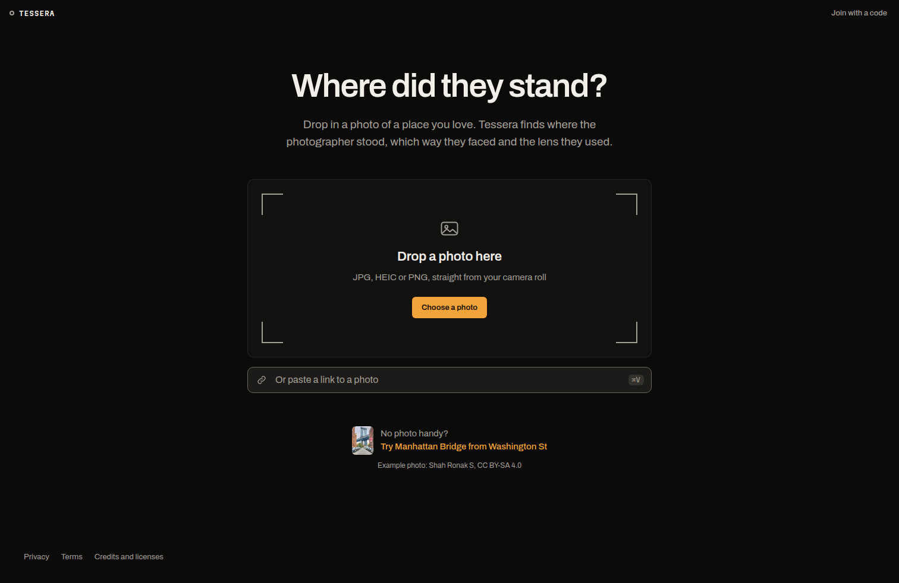
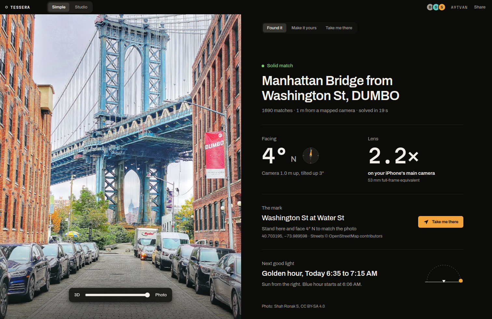

Tessera runs in the browser. There is nothing to install.

- **Simple:** https://app.tesseraphoto.com
- **The demo shoots:** Manhattan Bridge from Washington St, DUMBO at https://app.tesseraphoto.com/p/A9TVAN (Studio: https://app.tesseraphoto.com/studio/A9TVAN), and Empire State Building from Top of the Rock at https://app.tesseraphoto.com/p/7PL6L6

One spot is mapped today: **Manhattan Bridge from Washington St, DUMBO** in Brooklyn. Tessera can only place photos taken at a spot it has a 3D model of. A photo from anywhere else gets an honest "Couldn't place" instead of a guess.

## 1. Drop a photo

1. Open the app. The start page asks **Where did they stand?**
2. Drop a photo on **Drop a photo here**, press **Choose a photo** (JPG, HEIC or PNG, straight from your camera roll), or use **Or paste a link to a photo**.
3. No photo handy? Press **Try Manhattan Bridge from Washington St** (photo by Shah Ronak S, CC BY-SA 4.0) or **Try Empire State Building from Top of the Rock** (photo by Daniel Schwen, CC BY-SA 4.0). The second makes a fresh shoot placed on the observation deck at 259 m, facing 205° with a 65 mm lens, opening at 4:20 PM spot time. It is placed, not solved, and says so: "Placed by you · Set on the Top of the Rock deck".

What happens next, step by step on screen:

- The crew stores the photo, turns HEIC into JPEG, applies the EXIF rotation and reads the photo's GPS and focal length (with the digital zoom ratio applied).
- A new shoot starts: a SpacetimeDB session with a six-letter code, and the photo queued for a solve.
- The GPS picks the spot. If the photo has no location, Tessera asks **Which place is this?** and you pick the spot it shows.
- The solver matches the photo against the spot's 3D model. On our CPU this takes 11 to 18.5 s a photo (median 15.8 s on the held-out set). The page says "This usually takes about 20 seconds".

How it finds the camera: [Solve against the open 3D model](/docs/how-it-works/solve/).

## 2. Read the answer

**Found it** shows your photo over the 3D spot with a blend slider (3D on one end, Photo on the other) and the answer:

- **Facing:** the heading, in degrees from north, with a compass. The demo photo faces 4 degrees N, camera 1.0 m up, tilted up 3 degrees.
- **Lens:** the zoom on your phone ("2.2x on your iPhone's main camera") with the 35 mm-equivalent focal length in small type (53 mm for the demo photo).
- **The mark:** the latitude and longitude to stand on, and **Take me there**.
- **Next good light:** the next golden or blue hour for that heading.

The confidence line says how sure the solver is. There are three states:

| State | Simple says | When |
|---|---|---|
| Solid | Solid match | 200 or more matches, within 40 m of a camera in the spot model, and the lens inside the expected range |
| Check this | Likely match, check it | Enough matches, but the pose is more than 40 m from every mapped camera, or the solved lens falls outside the lens range the solver was given |
| Couldn't place | Couldn't place this photo | Under 200 matches. The cut-off sits between our one wrong answer (78 matches) and the weakest right one (336), and is not calibrated beyond that |

The reason line gives the count, for example "1690 matches, 1 m from a mapped camera, solved in 19 s". On "Couldn't place", Tessera asks **Know roughly which lens took it? It narrows the search.** and re-runs the solve with your hint as a range.

## 3. Make it yours

**Make it yours** has one-tap changes: **Golden hour**, **Blue hour**, **Add a friend**, **Add two friends**, **Portrait look** (85 mm at f/2) and **Wider** (24 mm). **Describe a change** takes a sentence ("a red bike on the left") or **Hold to talk**. **Make it** renders your version over your own photo, labelled "AI interpretation". Details: [Place people](/docs/guides/place-people/) and [The render pass](/docs/how-it-works/render/).

## 4. Invite friends

Press **Share** at the top. The sheet is titled **Plan this shot together**.

- **Invite a friend:** their name, then a phone number or an email. For a phone number, pick **iMessage**, **SMS** or **WhatsApp**. The crew sends the invite through Photon.
- **Or send the link:** **Copy link**, or show the QR code. A friend who scans it lands in Simple on their phone.
- **Join with a code:** anyone with the six-letter shoot code can join from the start page.

Everyone in a shoot edits the same set live. Friends on Simple and a photographer on Studio see each other's changes as they happen. How: [Live sync](/docs/how-it-works/live-sync/).

## 5. Reach the set by text

The set also lives in message threads through Photon: renders arrive in your thread, a reply to a version forks it, a photo from the street checks you in. Status on November 8, 2026:

- The production crew is connected to Photon's live API and event stream (`GET /api/photon/status` answers `"enabled": true`). Telegram is live: message @ShotMatchSetBot, or send it a photo of the Manhattan Bridge view and it answers with where to stand. iMessage, SMS, email, WhatsApp and the phone line have no public handle yet.
- The iMessage line, SMS, the voice number, email and WhatsApp Business each need a number, DNS records or testers set up by hand in Photon's dashboard. Until they are, Tessera publishes no number to text, and invites on those channels are saved and go out once the line exists.
- All five messaging mechanisms were proven end to end against a stand-in for Photon's Beta API, with the real crew, the real SpacetimeDB module and real NVIDIA models: 29 of 29 checks.

Details: [Messaging](/docs/how-it-works/messaging/).

## Simple or Studio

A switch at the top of every shoot flips between **Simple** and **Studio**. Both read and write the same rows, so you can change views at any time without losing anything.

- **Simple** (`/p/<code>`) is phone-first: Found it, Make it yours, Take me there.
- **Studio** (`/studio/<code>`) is the full set editor: the outliner, the asset library, gizmos, the shot camera with real lenses, render layers, the timeline, Conditions and live data. Start with [The virtual set](/docs/how-it-works/virtual-set/).

Your last choice is remembered on that browser, and a link opens in that view.
