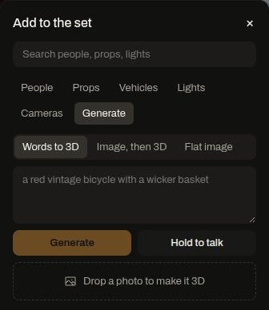

Generated props are objects that are not in the library: a red vintage bicycle with a wicker basket, a chalkboard cafe sign, your own jacket. NVIDIA models make them, and every one lands in the set at real-world size.

## From words

1. In Studio, open the asset library (**+** or **Shift+A**) and press **Generate a prop**.
2. Under **What to make**, pick a mode:
   - **Words to 3D:** TRELLIS builds a 3D model straight from your words.
   - **Image, then 3D:** FLUX makes a product-style concept image, Nemotron 3.5 Super VL describes it for a modeller, and TRELLIS builds from that description.
   - **Flat image:** an image at real size on a flat plane: a poster on a wall, a sign on a stand, a screen.
3. Type what you want under **Describe the prop**, or hold **Hold to talk** and say it (NVIDIA Parakeet transcribes it).
4. Press **Generate**. The steps stream in as they run, and the concept image appears when there is one.
5. The prop lands where you last clicked, selected, with the gizmo ready. The outliner tags it "generated · TRELLIS" or "image".

The inspector then shows the concept image, the prompt, the size, **Regenerate** and **From a photo**.

## From a photo or an image

1. Drag an image file onto the 3D view. Tessera asks **Drop the image where it should go**.
2. Choose:
   - **Place as image:** the image stands at that spot as a flat print at real size.
   - **Make it 3D:** Nemotron 3.5 Super VL finds the object in the photo, crops to it, describes it and gives its real dimensions, then TRELLIS builds the model.

You can also text a photo of one object into a shoot's thread. The crew turns it into a prop the same way and replies with where it landed: "Added a floor lamp to the set on the left, 5 m from the camera."

## Real size

Nemotron 3.5 Super gives the object's height, length and width in metres. A sedan read from a photo came out 4.6 x 1.85 x 1.45 m. The studio scales the model to that height and stands it on the ground.

## When TRELLIS or FLUX fails

On November 7, hosted TRELLIS text mode answered in about 10 s, but about half of the calls returned HTTP 500 after 60 to 90 s. Its image mode accepts only the endpoint's own example images, which is why photos reach 3D through Nemotron's description. FLUX.1-dev returned HTTP 500 on every base-mode call.

So the crew falls back, and the step log says which path ran:

- A failed TRELLIS call retries once.
- A photo or concept image then becomes a flat cut-out at real size instead of an error.
- A words-only request from the set agent gets the closest library prop.
- Without FLUX, "Image, then 3D" runs TRELLIS text mode, and posters use Qwen-Image 2.1 on Vultr.

A generation takes from about 1 s (a flat image from a photo) to about 3 minutes (TRELLIS retrying).

## Every session gets it

A generated prop is shared beyond your set. The module queues it for the public `shotmatch-library` database through an inter-database outbox, and every session's asset library then offers it. Results are cached by prompt, so the same words return the same model.
