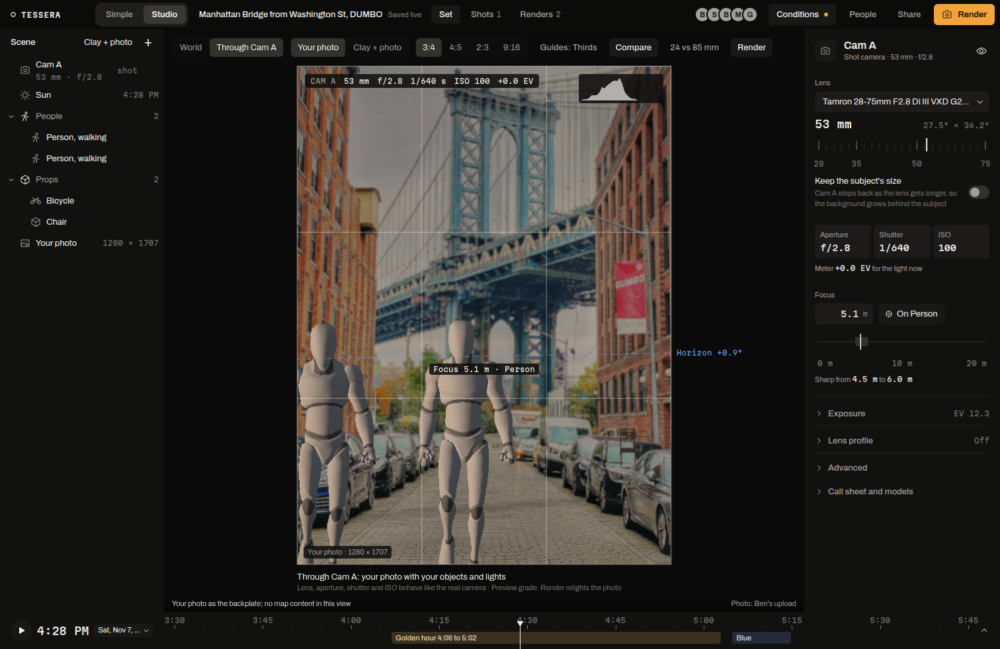

The shot camera, Cam A, starts where the original photographer stood, with the solved lens. Through Cam A you see exactly what that camera sees, with your objects over your own photo. Then you change the body, the lens and the settings like on a real camera.

## Open the view

1. Open the set in Studio (`/studio/<code>`).
2. Press **Through Cam A** in the view switch at the top left, or press **0**. **World** goes back to the free view; **Top** (or **7**) looks straight down with the camera's frustum.
3. Pick the **Backplate**: **Your photo** puts your objects over the real photo, which is what the render uses. **Clay + photo** shows the clay model with your photo projected onto it instead.

The readout on the frame shows the camera, focal length, aperture, shutter, ISO and exposure offset, and a focus label sits on the subject in focus.

## Body and lens

Select Cam A to open its inspector.

1. **Body** sets the sensor. **Lens** lists the lenses that fit it. The catalog has 19 bodies and 67 lenses, typed from the makers' published specifications: focal range, maximum aperture, minimum focus distance and aperture blades.
2. The big focal readout shows the real focal length and the field of view. Drag the lens ring under it to zoom. A zoom lens stays inside its range.
3. The 35 mm equivalent follows from the sensor's crop factor, so the same field of view reads as a different focal length on a smaller sensor.

## Exposure

- **Aperture**, **Shutter** and **ISO** are tiles you click to change.
- **Meter** reports the exposure against the light now, for example "+0.0 EV for the light now". It uses a sunny-16 sky model for the sun's altitude, not a light measurement.
- **White balance** sets the colour temperature in kelvin.

## Focus and depth of field

1. Set the focus distance in metres, or press the focus target (for example **On Person**) to focus on a subject.
2. The inspector draws the depth of field: "Sharp from 2.0 m to 2.2 m" at 51 mm and f/2.8 on the 2.1 m focus in the demo set, with the near limit, the far limit, the hyperfocal distance and the circle of confusion. Click the diagram to move the focus.
3. The view blurs what is outside that range. The math is thin-lens and rectilinear (`web/src/studio/optics.ts`, with a self-check); the blur on screen is a 48-tap gather, an approximation.

## Lens profile

Under **Lens profile**, the **Distortion** and **Vignetting** switches apply the lens's measured profile from the lensfun database (CC BY-SA 3.0). 59 of the catalog's lenses have a lensfun profile. A wide lens bends straight lines at the frame's edges, the way it would on the real lens.

Vignetting is a per-browser setting for now. The render layers stay rectilinear, without the distortion.

## Guides and aspect

- **Aspect** masks the frame: 4:3, 4:5, 3:2 or 16:9, turned to 3:4, 2:3 and 9:16 when the photo is portrait.
- **Guides** draws **Thirds**, **Golden** (golden ratio grid), **Spiral** (golden spiral) or **Off**.
- **Horizon** draws the horizon from the camera's pitch and roll. **Safe** shows action and title safe areas. **Grid** adds a grid.

## More cameras

Add another camera from the asset library's **Cameras** tab, frame it, then press **Make this the shot camera** in its inspector. Every camera shows its frustum and depth-of-field planes in the World view. Shot settings are one shared row, so everyone in the shoot sees the same lens and exposure.

## Then render

Press **Render** in the top bar. The render uses the shot camera, the backplate photo and your objects only. See [The render pass](/docs/how-it-works/render/).
