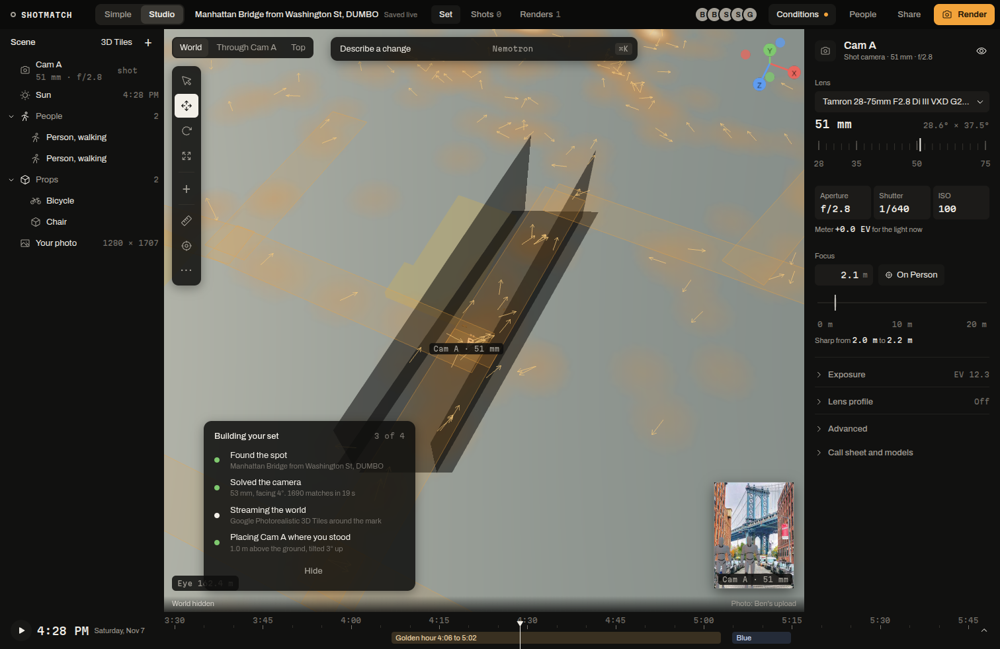

A good shot depends on more than the place: cloud for sunset colour, haze for the far skyline, a film permit holding the block, scaffolding on the facade, the tide under the bridge, the street falling into building shadow. ShotMatch pulls this from open sources for the spot and the set's time, shows it in the 3D set, on a 2D map and on the timeline, and hands it to the AI as one paragraph.

Everything works for any latitude and longitude in the US. NYC spots also get permits, closures, scaffolding and the city's own building heights. Code: `crew/src/layers/` (server), `web/src/layers/` (screens), tests in `crew/test/layers.test.ts`.

## Layers

| Layer | Source | License | Refresh | Why a photographer cares |
|---|---|---|---|---|
| weather | Open-Meteo hourly forecast | CC BY 4.0 | 15 min | Cloud by layer decides sunset colour and how soft the light is. Visibility and humidity decide how far you see. Wind decides hair, flags and long exposures |
| haze | Open-Meteo air quality (CAMS model) | CC BY 4.0, Copernicus | 15 min | PM2.5 and aerosol optical depth say whether the skyline will be crisp or washed out on a long lens |
| alerts | National Weather Service active alerts | Public domain | 5 min | Wind, flood, heat and storm warnings with their areas |
| quakes | USGS earthquake catalog, 300 km, 30 days, M1.5 and up | Public domain | 15 min | Context and the rare real hazard. 2D map only |
| film (NYC) | Film permits (Mayor's Office of Media and Entertainment) and permitted events (Street Activity Permit Office) | NYC Open Data | 24 h | A film crew or a parade holding the block takes it out of your shot |
| closures (NYC) | DOT street closures, by block and by intersection | NYC Open Data | 24 h | A closed street means barriers, plates and trucks in frame |
| construction (NYC) | DOB NOW approved permits: sidewalk sheds, scaffolds, construction fences | NYC Open Data | 24 h | Scaffolding is the most common thing that ruins a facade shot |
| tides | NOAA CO-OPS predictions, nearest station within 30 km | Public domain | 6 h | At DUMBO the rocks and Pebble Beach under the bridge only show at low tide |
| buildings, shadow | NYC building footprints with roof heights; OpenStreetMap elsewhere | NYC Open Data; ODbL | 24 h | The street goes into building shadow hours before sunset |
| pois | OpenStreetMap through Overpass: viewpoints, transit, parking, restrooms, cafes | ODbL | 24 h | Where to stand, how to get there, where to park and wait |
| photographers | Our own geotagged Wikimedia Commons photos (spot model and lens dataset) | Each photo's CC license | at start | Where people actually stand for this shot, and which way they face |
| moon | suncalc | BSD 2-Clause | computed | Moonrise and phase for night and blue-hour shots |

A source that takes longer than 14 s answers "still loading" while its fetch carries on, so one slow server never holds up the rest. A failed refresh serves the last good copy, marked stale. Cached, the whole set answered in 348 ms on linuxbox and 611 ms on the Vultr VM; cold, about 14 s.

## The rules behind the numbers

**Colour chance** (`colorChance` in `crew/src/layers/score.ts`). The physics comes from Corfidi (NOAA Storm Prediction Center, "The Colors of Sunset and Twilight"): the colour is sunlight reddened along a long path through clean air, and it shows best on mid and high cloud that the low sun still lights from below. Low cloud near the horizon blocks that light, and haze mutes it. The thresholds are ours:

- The canvas is the mid or high cloud cover, `1 - (1 - mid)(1 - high)`. Under 5% it scores 20. It rises to 90 at 30%, holds 100 from 30% to 70%, and falls to 45 at full cover.
- Low cloud over 15% scales the score down, to a tenth at 80% and above.
- A rain chance over 50% multiplies it by 0.7. Aerosol optical depth over 0.35 takes off up to 30%.
- Good is 65 or more, fair 35 to 64, poor below 35. The score uses the forecast hour nearest each sunrise and sunset.

**Haze.** The worse of two readings names it. PM2.5 uses EPA's 2024 AQI breakpoints (good to 9.0, moderate to 35.4, sensitive groups to 55.4 ug/m3). Aerosol optical depth: under 0.15 is clean, 0.3 visibly hazy, 0.6 thick.

**Building shadow** (`shadowAt`, `shadowBands`). From a point on the street, the sun's ray runs toward the solar azimuth and rises at the sun's altitude. The point is in shadow when the ray enters a footprint below that building's roof. The probe points are the middle of the street at the mark (from our own street geometry) and 10 m in front of the shot camera, sampled every 5 minutes from sunrise to sunset. The 2D map draws each building's shadow at the set time; that is exact for convex footprints and slightly too full for L-shaped ones.

**Projection.** The server uses a local equirectangular projection around the spot, within 0.5 m of the haversine distance over 500 m (tested). The 3D set converts on the WGS84 ellipsoid.

## A real answer for DUMBO

`GET /api/layers/conditions` for Sunday, November 8, 4:20 PM:

> 2% mid cloud; sunset 4:46 PM: fair colour chance (37; 11% mid and high cloud to catch the light, no low cloud in the way); high tide 7:54 PM (4.5 ft), then low 1:49 AM; sidewalk shed and supported scaffold at 30 Washington Street, 41 m away (DOB permit until Apr 1); ...; the middle of the street at the mark is in shadow until 11:00 AM, then sunlit; in building shadow from 12:00 PM to sunset; wind 10 mph gusting 18, 58°F; clear air (PM2.5 6).

## Where it shows

- **3D set:** building shadow casters, permit and closure zones on the street, 3 m volumes for sheds and scaffolds, place pins, the photographer heatmap with heading arrows and the three busiest spots, an alert drum when the spot is inside an NWS alert area, and the shadow probe ring. None of it enters a render, and none of it comes from Google's tiles.
- **2D map:** MapLibre GL with OpenFreeMap's keyless "dark" style ("OpenFreeMap © OpenMapTiles, data from OpenStreetMap" stays on the map): the same layers plus building extrusions, shadows at the set time, quakes, the tide station and the shot camera's view cone. Past 300 m of camera height it also serves as the overview.
- **Timeline:** cloud low, mid and high plus rain per hour, a hatched "street in building shadow" band, and high and low tide marks.
- **Conditions drawer:** press **Conditions** in Studio's top bar for the paragraph, chips (colour chance, next tide, street shadow, wind, haze, moon, alerts), the map, the layer switches and the sources.
- **AI:** the paragraph goes to Nemotron for the call sheet, the art director and questions to the set agent ("will the sunset be any good?"), and into Photon's golden-hour texts.

## Shared through SpacetimeDB

Weather and alerts also live in the database: the `refreshLayers` procedure fetches them every 15 minutes for active spots and writes `layer_snapshot` rows, so every client refetches when a new snapshot lands. Which layers a set shows is shared through `layer_toggle`, so everyone on a set sees the same layers.

## Known limits

- NYC's film permit dataset stops at August 9, 2026. The layer shows the past year per block ("16 film permits in the last year on Prospect Street") plus live permitted events.
- The public Overpass servers were at capacity on November 7 and 8. The crew tries three mirrors and keeps a 24 h cache. NYC buildings and streets come from NYC Open Data, so NYC does not depend on Overpass.
- Crime data is left out on purpose. It stigmatizes neighbourhoods and adds nothing to a photo.
