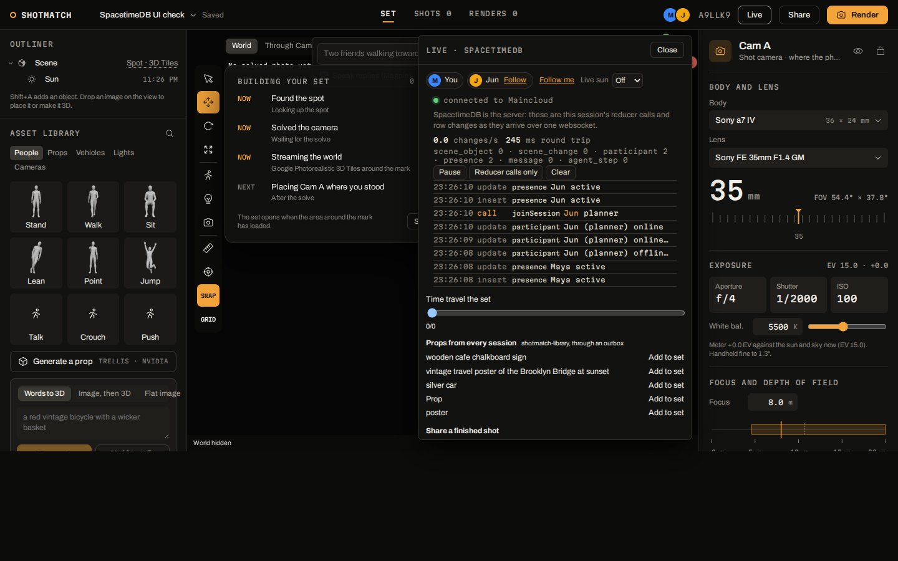

Everything a shoot is lives in SpacetimeDB: the session, its people, the photo and its solve, every object in the set, the camera settings, render jobs, messages, versions and check-ins. The module is one TypeScript file on Maincloud (`module/src/index.ts`, database `shotmatch`, SpacetimeDB 2.14.1). There is no application server between the browser and the data, no websocket layer of ours, no queue and no cron.

Every client opens one websocket to Maincloud and subscribes to its session's rows. Every write is a reducer call: validated, atomic, and pushed to every subscriber as soon as it commits. The full table and reducer list is in [SpacetimeDB reference](/docs/reference/spacetimedb/).

## Who sees what

Row-level security filters every session table: a client receives a session's rows only if it is a member of that session, plus the crew identity, which sees every session. Each filter joins the `session_member` table.

- A newcomer can't see a session they haven't joined. They read the `session_card(code)` view to see its title, spot and who is online, then call `joinSession`. The six-letter code is the capability.
- Spots, the public library views and `live_sessions` (counts only, no codes or titles) stay public.
- Proof (`module/scripts/proof.ts`, two fresh identities against production): the outsider, subscribed to every table, received 0 sessions, 0 participants, 0 objects and 0 history rows of the other person's session. After joining by code they received the session, its 2 participants and its objects at once.

## Presence and ephemeral events

- `heartbeat` keeps a `presence` row per person: their colour, active or idle, and the object they have selected. The `presenceSweep` schedule runs every 10 s, marks a silent editor idle after 30 s, drops them after 2 minutes and frees any gizmo lock they held.
- `set_event` is an event table: cursors on the ground, laser pings ("Maya is pointing here"), shared camera views and follow requests. Rows reach each member once and are never stored. The official Rate Limit module caps each sender at 40 events a second and 8 pings per 10 seconds; a 12-ping burst let 7 through and refused 5.
- `toast` carries notices such as "Shot located" and "Maya reached the spot". `activity` names every reducer call in the session, so the Live data feed can show other people's calls.

## Scene history

Every edit to a `scene_object` writes a `scene_change` row with the object's state before and after, who made it and when. A drag (one person, one object, edits less than 2 s apart) folds into one entry: the load test's 900 edits left 6 history rows.

- `undoSceneChange` puts one object back the way it was before a change, whoever made it.
- `restoreSceneTo` rewinds the whole set to any point in one transaction. A restore is itself a history row, so it can be undone.
- A text thread's versions (v1, v2, v1.1) point at `scene_change` ids, so going back to a version is a restore. See [Messaging](/docs/how-it-works/messaging/).

## Jobs with leases

Solves and renders are rows that the crew claims:

1. `addPhoto` queues a `solve_job`.
2. The crew calls `claimJob` and holds a 60 s lease (renders get 180 s). `reportProgress` writes each progress line and renews the lease.
3. `finishJob` writes the `solve_result` and moves the shared camera.
4. The `sweep` schedule runs every 10 s. A job whose lease ran out goes back to the queue, up to 3 attempts. Kill the crew mid-solve and the job comes back and finishes after a restart.

A render's layers live only in the crew's request, so an expired render fails instead of requeueing.

## Schedules in the database

| Schedule | Every | Does |
|---|---|---|
| `sweep` | 10 s | Requeues jobs from a worker that stopped renewing |
| `presenceSweep` | 10 s | Idle after 30 s, gone after 2 minutes, locks freed |
| `sunTick` | 1 s, per session | Moves the set's clock: live (1x), 60x or 600x. 600x moved the set 30.0 minutes in 3.2 s. Everyone's sun moves together |
| `fireReminder` | once | The golden-hour reminder: a toast plus an outbox row the crew texts out |
| `titleSession` (procedure) | once, after the first solve | Names an untitled shoot |
| `refreshLayers` (procedure) | 15 minutes | Weather and NWS alerts for active spots |

## Procedures that call out

A procedure can make HTTP calls from inside the database.

- `titleSession` reads the spot, lens, heading, plan time, people and what the group said, calls NVIDIA's Nemotron 3.5 Lightning, and writes the title, an `agent_step` row and a toast. The NVIDIA call took 121 to 126 ms ("Washington Street Bridge View", "Northward Frame").
- `refreshLayers` fetches the hourly forecast from Open-Meteo and active National Weather Service alerts, and writes one `layer_snapshot` row per spot and layer. Measured on production: weather 90 ms, alerts 212 ms.

The NVIDIA key and the ElevenLabs webhook secret are database environment variables, set at publish time. They are never in source and never reach clients.

## HTTP routes in the module

Served at `https://maincloud.spacetimedb.com/v1/database/shotmatch/route/...`:

- `GET /health`: counts read in a transaction.
- `GET /shot?code=<share code>`: public JSON for a shared shot.
- `POST /hooks/elevenlabs`: the phone agent's post-call webhook. The module checks the HMAC-SHA256 signature itself, rejects anything older than 30 minutes, ignores retries of the same conversation, and writes the transcript into the session's `message` rows.

## The public library

A second database, `shotmatch-library`, holds generated props and shared shots for every session. When the crew adds a generated prop to any set, the same transaction queues it in `publish_prop_outbox`. SpacetimeDB delivers the call exactly once, in order, after the transaction commits. The library accepts calls only from databases on its `trusted_db` list. Every session's asset library then offers the prop. Real TRELLIS props ("wooden cafe chalkboard sign", "silver car") went through it in production.

## Measured

Load test (`module/scripts/loadtest.ts`): 3 headless clients in one session, each dragging its own object at 10 Hz for 30 s like the studio's gizmo, against production with row-level security on.

| Run from | Committed | Round trip p50 / p95 / p99 | Another client sees it p50 / p95 / p99 |
|---|---|---|---|
| linuxbox, home Wi-Fi, run 1 | 900 of 900 | 42 / 409 / 638 ms | 41 / 432 / 649 ms |
| linuxbox, home Wi-Fi, run 2 | 900 of 900 | 44 / 144 / 341 ms | 43 / 152 / 348 ms |
| Vultr VM, Dallas | 900 of 900 | 50 / 199 / 750 ms | 50 / 221 / 846 ms |

The median round trip equals one network round trip. `proof.ts` passes 38 of 38 checks on a scratch database and 19 of 19 on production.

## In the app

Open a set in Studio and press **People** (people and live data). The Feed streams this session's reducer calls and row changes as they arrive, with changes per second, the measured round trip and how many rows this client can see. **Time travel the set** scrubs history and restores it. The library list shares shots and offers props from every session. **Live sun** sets the shared clock: Off, Live, 60x or 600x.

## Known limits

- Row-level security is marked experimental in SpacetimeDB's docs.
- A filter can't join a table that has filters of its own, so `session_member` is public: anyone can see which anonymous identities belong to which numeric session ids, but no names, codes or content.
- Clients built with older bindings fail to decode a table that gained columns, so every such publish is followed by regenerating bindings and redeploying the crew.
- HTTP routes have no path parameters, hence `/shot?code=`.
