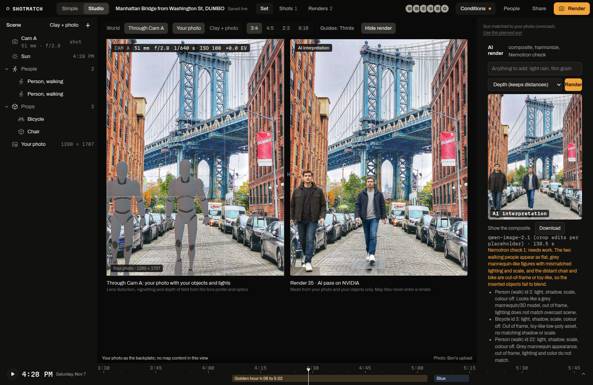

A render is your version of the shot: the objects you placed, lit by the right sun, inside your own photo. Tessera does not repaint the photo. It composites your objects in, lets an image model blend only around them, and then checks the result.

The right-hand image above is an AI render, and the app labels it "AI interpretation". It is not a record of a real moment.

## 1. Render layers

The browser renders only your objects and lights, from the shot camera, at the photo's pixel size (`web/src/studio/render/layers.ts`):

| Layer | What it is |
|---|---|
| beauty | RGBA, transparent wherever nothing of yours is. Lit by the sun, your lights and image light taken from the photo |
| shadow | shadows only, as alpha: sun shadows on the street geometry plus contact shadows under feet and wheels |
| depth | 8-bit grey, white is near |
| mask | one flat colour per object, with a legend mapping colours to `scene_object` ids |

The 3D world (Google's tiles or the clay model) and every editor helper (gizmos, frustums, the grid, light icons) are switched off for the whole capture. Tile pixels and tile depth never reach a render. The browser posts the layers to `POST /api/render`. Street View panoramas are display only as well: they never enter a render and are never sent to a model.

The 3D sun comes from the set's clock and the spot's position (suncalc). Nemotron 3.5 Super VL also reads the light in your photo (`GET /api/set/light`), so the crew can flag a sun that is on the wrong side.

## 2. Composite

`crew/src/composite.ts` (tested):

- The shadow pass is multiplied into your photo, blurred and darkened to match the shadow hardness Nemotron read from it.
- The beauty layer goes on top. Each object's exposure and white balance move part of the way toward the photo around it, each keeping its own colour, and grain is added to match.

This takes about 0.6 s. With no generator available, the composite alone is the result, labelled "Composite".

## 3. Harmonize

An image model renders the frame from the composite. Its pixels are blended in only over your objects and their contact areas, at a strength of 0.45 by default (the request can set 0.1 to 0.9). Outside that mask your photo is untouched, pixel for pixel, so the street and the buildings stay exactly where they were.

The generator is FLUX.1-dev on NVIDIA's API in depth or canny mode. On November 7, FLUX returned HTTP 500 on every base-mode call, and its depth and canny modes accepted only the endpoint's example images. So the render ran on the fallbacks, blended through the same mask: Qwen-Image 2.1 on Vultr Serverless Inference, then OpenAI gpt-image-2. Every result names the model that ran.

## 4. Verify and fix

Nemotron 3.5 Super VL, with reasoning off (on only for a retry when that answer is unusable), looks at the render and checks each placed object: the light direction, the shadow direction and softness, the scale next to doors, cars and people, and the colour and grain. Nemotron 3 Nano Omni gives a second physics opinion while Cosmos Reason2 is unavailable to our key.

On a fail, the crew raises the blend strength (objects still look pasted on) or lowers it (the scene changed too much), or adds words to the prompt, and renders once more. If the 3D sun is more than 60 degrees from the light in the photo, the result carries a `sunFix` with the azimuth and altitude to use.

Measured on the public app (test session, Qwen-Image as the generator):

| Step | Time |
|---|---|
| Composite | 0.6 s |
| Check 1 | 3.9 s, failed: "lit from a low side angle while the real scene is flat overcast" |
| Strength raised to 0.70, re-render, check 2 | 5.5 s |
| Nano Omni second opinion | 1.2 s, called the test object "disproportionately large compared to the surrounding buildings" |
| Total | 29 s |

## The result

The crew saves the image, records it as a `preview_job` row with `kind = 'render'`, and every screen in the session shows it. The response carries the composite and the render, the model, the prompt, each check, the strength, the `sunFix` and the label "AI interpretation".

- In Studio, **Render** in the top bar opens the render panel: a text field for extra words, **Depth (keeps distances)** or **Canny (keeps edges)**, the checks, and the before and after.
- In Simple, **Make it** on Make it yours runs the same pass. If the 3D layers or the crew are not available, Simple falls back to a quicker preview made from your photo and says so on screen.
- Over Photon, every render becomes a numbered version (v1, v2, v3) sent to each person's channel. See [Messaging](/docs/how-it-works/messaging/).

## Known limits

- The render layers are rectilinear: they leave out the lens distortion and are not tone-mapped.
- Exposure uses a sunny-16 sky model, not a light measurement.
- A render is an interpretation. The check catches lighting and scale errors it can see; it does not prove the image is right.
