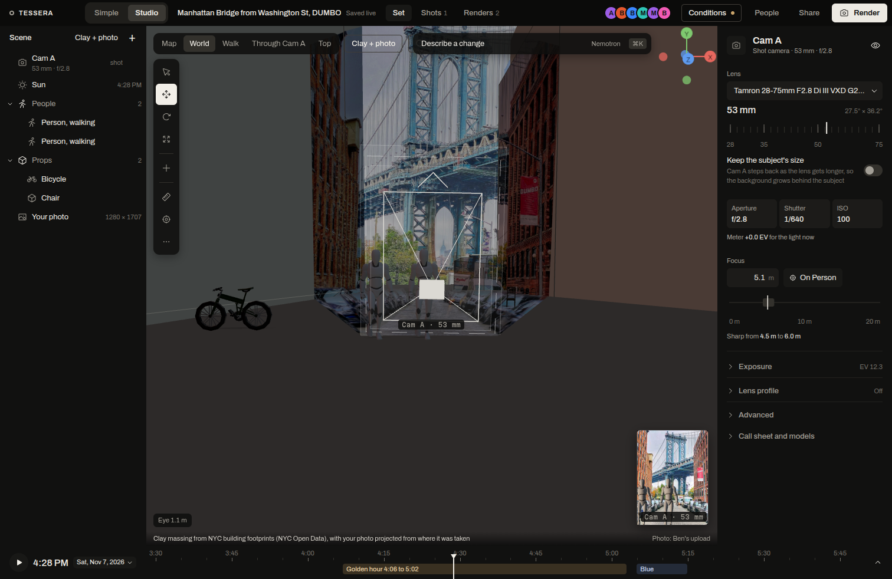

Once a photo is placed, ShotMatch builds the spot as a 3D set around the mark. You work in it like a small film set: place people and props, light them, and frame the shot through a camera with a real lens. Studio (`/studio/<code>`) shows the whole set. Simple shows the same set through the shot camera.

## Every object is a row

Each thing in the set is one `scene_object` row in SpacetimeDB:

| Column | Holds |
|---|---|
| `kind` | `model`, `person`, `light`, `camera`, `prop_generated` or `text` |
| `assetId` | a catalog id, or a `/asset/<id>.glb` URL for a generated prop |
| `x`, `y`, `z` | metres east, north and up from the spot's centre |
| `qx`, `qy`, `qz`, `qw`, `scale` | rotation as a quaternion, and scale |
| `color`, `intensity`, `lightType` | for lights: colour, lux or candela, and `sun`, `point`, `spot` or `area` |
| `params` | small key=value settings: a person's pose, a camera's focal length and aperture |
| `visible`, `lockedBy` | hidden or shown, and who holds the gizmo |

Studio, Simple, the crew (Nemotron's edits) and the phone agent all write these rows through reducers. Every client subscribed to the session draws the same set. See [Live sync](/docs/how-it-works/live-sync/).

## The frame

The set uses a local east-north-up frame in metres, centred on the spot row's latitude and longitude (`web/src/studio/frame.ts`, which converts on the WGS84 ellipsoid). A row at `x = 5, y = 10, z = 0` sits 5 m east and 10 m north of the spot centre, on the ground.

## The world around the set

The backdrops, switched in the outliner's Scene row:

- **Earth** (the default): Google Photorealistic 3D Tiles through `3d-tiles-renderer`, opening like Google Earth from 300 m out, with Google's logo and credits on screen whenever they draw. Display and editing only: they never enter a render layer, an export, an AI step or a placement raycast.
- **Clay + photo:** clay massing of the block from NYC building footprints (NYC Open Data), with your photo projected onto it from the pose the solver found. It is the sharpest view at street level near the shot; Earth offers a **Sharper here** button that switches to it.
- **Clay** (the massing alone) and **Hidden** (just your objects on the street geometry).

We trained a Gaussian splat of the spot on an NVIDIA A100 and cleaned it with NVIDIA Difix3D; at street level it wasn't clear enough to ship, so the 3D world uses Google's tiles and our clay model with the user's photo projected onto it.

## Street geometry

`spots/nyc_dumbo/geometry.json` is built from our own SfM model (`splat/street_geometry.py`): the street heading (359.8 degrees), its width (20.6 m), the ground plane (it slopes 5.2 degrees down to the north) and the west and east facades as planes (0.3 m RMS). The studio uses it to:

- stand people and props on the sloped ground when you place or snap them;
- catch shadows on the ground and the facades;
- hide objects behind the buildings when seen through the shot camera (the facades are depth-only occluders, set 1 m back).

The geometry has about 1 m of error.

## What you can place

The asset library has tabs for **People**, **Props**, **Vehicles**, **Lights** and **Cameras**, plus **Generate**. Press **+** or **Shift+A** to open it.

- **People:** a posed mannequin (Quaternius, CC0) with nine poses: stand, walk, sit, lean, point, jump, talk, crouch and push. Height defaults to 1.7 m.
- **Props and vehicles:** 17 models from Poly Pizza (Quaternius, Kenney and Zsky), scaled to real size at load: cars, a taxi, an SUV, a bike, a bench, a chair, a table, a parasol, flowers, a potted plant, street lights, a traffic light, a cone, a hydrant, a trash can and two signs.
- **Lights:** Directional, Point (bare bulb), Spot and Area (softbox), in physical units scaled by the scene's metered exposure. The sun is its own row, driven by the set's clock.
- **Cameras:** each camera draws its frustum and depth-of-field planes. **Make this the shot camera** picks which one renders. The first one, Cam A, starts at the solved pose.
- **Generated props:** words, a photo or an image become a 3D model or a flat print at real size. See [Generate a prop](/docs/guides/generate-a-prop/).

## Editing together

- Select an object and press **G** (move), **R** (rotate) or **S** (scale). Dragging takes a lock with `lockSceneObject`, streams `updateSceneObject` at 10 Hz and unlocks on drop. Someone else's lock shows as a coloured tag, and a second person who grabs it gets "someone else is moving this object".
- A frozen tab can't hold a lock forever: the presence schedule marks a silent editor idle after 30 s, drops them after 2 minutes and frees their locks.
- **Ctrl+Z** and **Ctrl+Shift+Z** undo and redo your own edits. The History tab in live data can undo anyone's change or restore the whole set to an earlier point.
- **L** (or Alt+click) is a laser pointer everyone sees. **M** measures between two points on the street.
- Other shortcuts: **W** or **Q** select, **X** or **Delete** removes, **F** frames the selection, **H** hides it, **0** looks through the shot camera, **7** is the top view, **1**, **3** and **5** are front, right and home, **Tab** is focus mode, **Ctrl+K** opens the Nemotron command bar.

## Simple and Studio share the set

Simple's presets write the same rows: **Add a friend** sends a sentence to Nemotron, which places a `person` row; **Portrait look** and **Wider** change the shared shot settings; **Golden hour** moves the set's clock. A friend on Simple and a photographer on Studio see each other's changes as they land.

## VR

**Enter VR** appears only in a browser that supports immersive WebXR. It teleports on the street at 1:1 scale. Untested on a headset.
