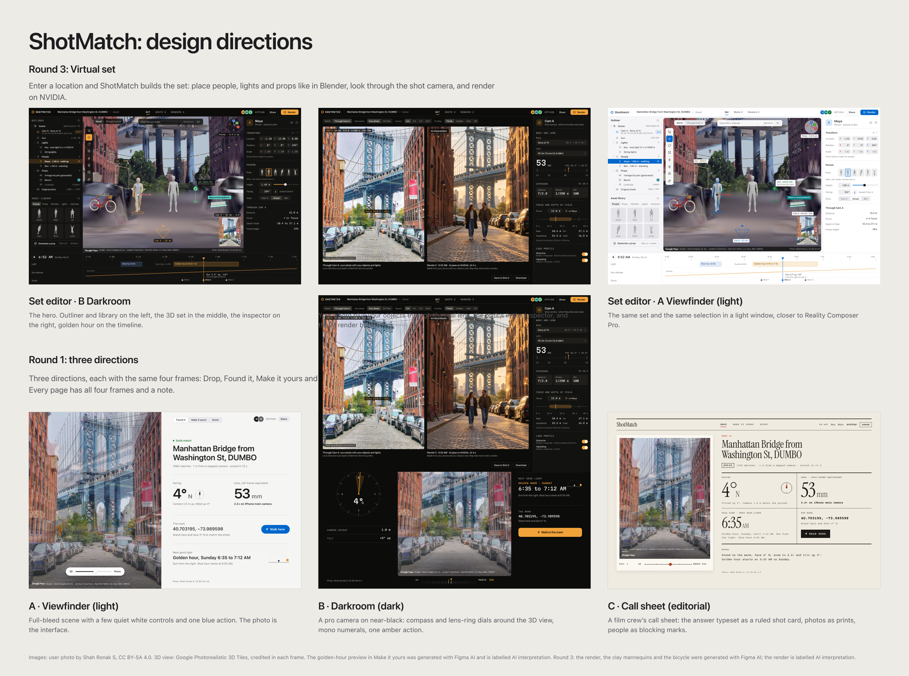
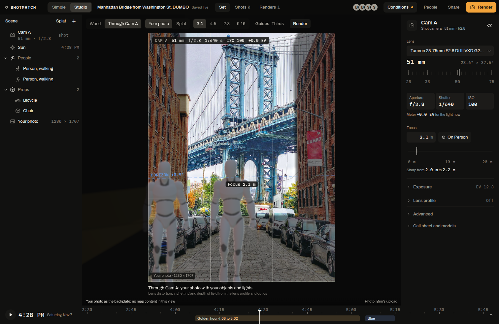

ShotMatch was designed before it was built. Three directions in Figma drew the same four screens (drop a photo, found it, make it yours, scout), then a third round drew the virtual set. The dark "Darkroom" direction became Studio, a set editor for photographers; the light "Viewfinder" direction became Simple, a phone-first view for everyone else. Both read and write the same live set, so a friend on Simple and a photographer on Studio edit one shot together, and one toggle switches between them.

**Best shown in:** Simple on a phone (`/p/A9TVAN`) and Studio on a laptop (`/studio/A9TVAN`), side by side.

## The problem

The answer ShotMatch gives is technical: a position, a heading, a 35 mm-equivalent focal length, a confidence, a sun angle. A casual user needs it as "stand here, face this way, zoom to 2.2x". A photographer needs the full camera: body, lens, aperture, depth of field, the light. One interface can't serve both without hiding the numbers from one group or burying the other in them. And a tool that guesses where a photo was taken has to show how sure it is, and has to say clearly when an image is AI-made.

## What ShotMatch builds for it

- **Round 1: three directions, same four frames.** A Viewfinder (light): the photo carries the screen, a few quiet controls and one blue action. B Darkroom (dark): the answer as camera instruments around a central viewfinder, Archivo with Martian Mono numerals, one amber action. C Call sheet (editorial): a ruled film-crew shot card, photos as prints, people as blocking marks.
- **Round 3: the virtual set.** Seven frames: enter a location, the set editor in B and in A, the Nemotron command bar with a generated prop, Through Cam A with the render, the phones (iMessage and scout), and a VR concept.
- **The pick.** B for Studio: in a set editor the scene, the photo and the render must be the brightest things on screen, and dark chrome matches the tools creators already use (Blender, Capture One, Resolve). A for Simple: calmer, closer to the phone and iMessage side.
- **Controls that explain the answer.** In the Darkroom frames a compass cone draws the lens's field of view; Studio's draggable lens ring shows where the focal length sits in the lens's range; Simple blends the photo over the 3D view with a slider, so you can check the match yourself.
- **Honesty designed in.** "Couldn't place" is a designed state, not an error. Every AI image carries "AI interpretation". Every tile view shows Google's logo and data credit; every frame that uses a photo shows its credit.

## Features

| Feature | Why it is there (criterion) | Where it lives | Proof |
|---|---|---|---|
| Two views over one set | One product for casual users and pros, without forking the data | `web/src/simple/`, `web/src/studio/`, the Simple/Studio toggle | Both views run on session A9TVAN; the toggle is in Simple's header and Studio's top bar |
| The answer in plain words | Usability for people who don't know focal lengths | `web/src/simple/Found.tsx` | "Solid match", "4 degrees N", "2.2x on your iPhone's main camera" with "53 mm full-frame equivalent" in small type |
| Instruments in Studio | Precision for photographers | `web/src/studio/` (camera inspector, lens ring, DOF diagram) | Lens ring with the real focal range, depth of field "Sharp from 2.0 m to 2.2 m", exposure meter in EV |
| Design tokens from Figma | The build matches the design | `web/src/studio/studio.css` tokens from frames 25:2 and 30:76 via the Figma MCP | Colours are CSS variables, so the A theme is a token swap |
| Honest states | Trust: the user can see how sure the answer is | Simple and Studio confidence states, render labels | "Couldn't place" on the 75-match photo; "AI interpretation" on every render |
| Credits on screen | Respect for the photographers and the map provider | Studio credits band, Simple photo credit, `/credits` | "3D scene trained from photos by 26 Wikimedia Commons contributors, CC BY-SA 4.0" on the splat view |
| Accessibility | Usable by more people | `web/src/simple/simple.css`, `web/src/studio/studio.css` | Text contrast passes AA in the Figma frames (ratios in each page's note); Simple's main buttons and fields are at least 44 px tall; both stylesheets honour `prefers-reduced-motion`; Studio has keyboard shortcuts (G, R, S to move, rotate, scale; F focus; 0, 1, 3, 5, 7 views) |

## Screenshots

The Figma cover (file QrpLuCwKGGFFBSDRMd7VqS): round 3 on top, the three round-1 directions below. These are design mockups.

Simple, built from direction A: the answer in plain words, the photo over the 3D view with a blend slider.

Studio, built from direction B: looking through the shot camera with a real lens, depth of field and composition guides.

## Why it fits Best Design

The design does work in the product: the lens ring and the compass explain the solve, the blend slider lets the user verify it, and the confidence states say when not to trust it. Two interfaces exist because two kinds of people use the same shot, and they share one set instead of exporting files to each other.

## Core vs track

From the ShotMatch core:
- the solver, the set and the optics that the screens present
- the live session in SpacetimeDB that both views share

For the design track:
- the three Figma directions and the round 3 set designs
- Simple's and Studio's interfaces, tokens and states
- the on-screen credits and honesty labels

## Known limits

- The Figma frames used some invented values (a person's position, step timings, a 12.4 s render time); they are listed in `design/REPORT.md` and are not product numbers.
- The VR frame is a concept; "Enter VR" in Studio is untested on a headset, and the wrist menu and floating monitor are not built.
- Studio's exposure uses a sunny-16 sky model, not a measurement, and the render layers are not lens-distorted.
- Simple's accessibility was built to its brief (AA contrast, large tap targets, keyboard reachable, reduced motion) and checked in screenshots; no screen-reader audit was run.

## How to check it

- Figma: https://www.figma.com/design/QrpLuCwKGGFFBSDRMd7VqS (pages A, B, C and "Round 3: Virtual set"). The file is private to the team, so a logged-out visitor sees a not-found page; the exports on this page are the same frames.
- Simple: https://104-238-146-229.sslip.io/p/A9TVAN; Studio: https://104-238-146-229.sslip.io/studio/A9TVAN
- Design notes and derived numbers: `design/REPORT.md`; screenshots of every step: `web/screenshots/simple-*.png` and `studio-*.png`

## Video

**From Figma to two interfaces** (about 2:00). A screen recording that walks the Figma directions, then the same screens in the live app.

| Time | On screen | Narration | Criterion it shows |
|---|---|---|---|
| `0:00` to `0:15` | Simple on a phone-sized window: drop the DUMBO photo, the solving steps | You saw a photo and want your own. The answer is technical, so we designed how to say it before writing code. | Problem first |
| `0:15` to `0:40` | Figma cover: pan across A Viewfinder, B Darkroom, C Call sheet | Three directions for the same four screens: a light viewfinder, a dark set of camera instruments, and a film crew's call sheet. | Process |
| `0:40` to `1:00` | Figma round 3: the set editor in B, then in A | Then the virtual set. Dark won for the editor: the scene, the photo and the render are the brightest things on screen. | Rationale |
| `1:00` to `1:25` | Live Simple `/p/A9TVAN`: Found it; drag the 3D to Photo slider; tap Make it yours | Simple says it in plain words: face 4 degrees north, 2.2x on your iPhone. Slide to check the match yourself. | Usability |
| `1:25` to `1:45` | Tap Studio in the toggle: Through Cam A, turn the lens ring, the depth of field diagram updates | Studio gives a photographer the real camera: lens, aperture, depth of field, the light. Same set, same moment. | Two views, one set |
| `1:45` to `2:00` | The "Couldn't place" state for the 75-match photo, then a render labelled AI interpretation | And it is honest: it says when it can't place a photo, and labels every AI image. | Trust |

Recording notes: Figma in presentation mode on the cover page, then the round 3 page. Simple at 393 x 852 for the phone beats, Studio at 1512 x 982. The "Couldn't place" beat needs held-out photo `d0473.jpg` from `spots/nyc_dumbo/test/` dropped into a test session, not A9TVAN.
