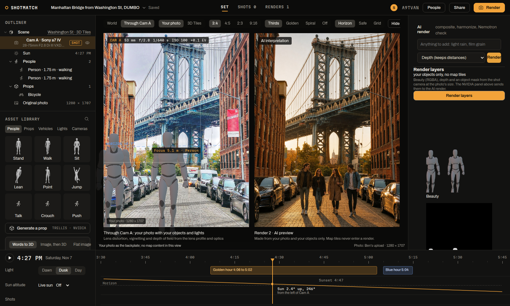
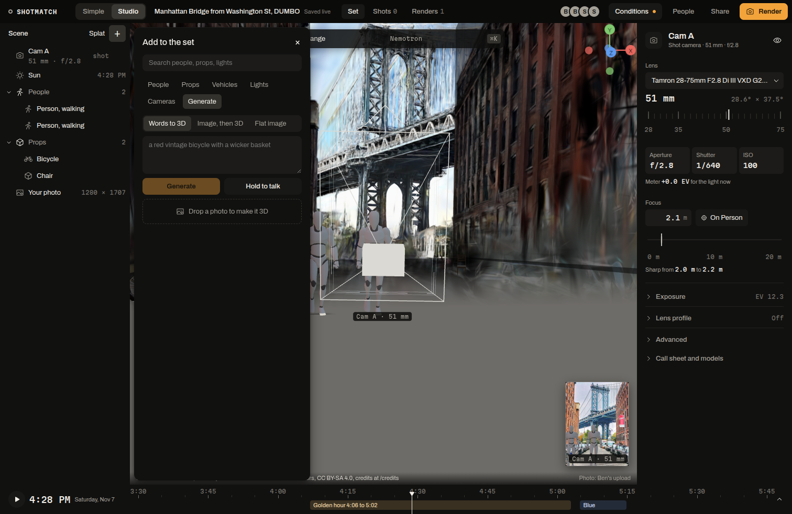
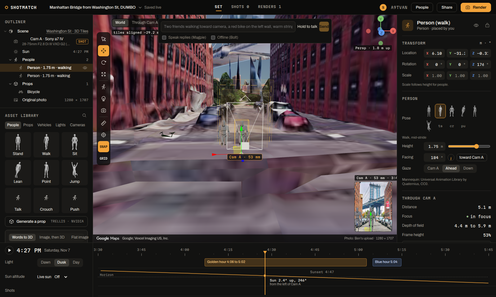

Nemotron does the work between your words and the set. Say "two friends walking toward camera, a red vintage bike on the left wall, warm string lights" and Nemotron places 16 objects where the shot camera sees them. It reads your photo and rebuilds what it saw as stand-ins, checks every render's light and scale before you see it, makes props at real size, critiques the composition, writes a call sheet timed to the real golden hour, and listens and speaks. Each step writes an `agent_step` row to SpacetimeDB, so the studio shows the trace while it works. We also fine-tuned Nemotron Nano 12B v2 VL to read the lens of any photo and serve it on our own GPU.

**Best shown in:** Studio (`/studio/A9TVAN`), with the Nemotron command bar, the render panel and "Powered by NVIDIA" open. Simple's "Describe a change" and the text threads call the same command.

## The problem

You found the spot. Now you want your version of the shot: two friends walking, a bike against the wall, the light at golden hour. Building that in a 3D editor means dragging every object into place and guessing whether it will look real in the photo. Most people on a shoot can describe the shot in a sentence but will never drive a 3D tool. A chatbot that answers in text doesn't help: the words have to become objects in the right place, at the right size, under the right sun, and the result has to be checked against the real photo.

## What ShotMatch builds for it

Nine workflows, each a pipeline of Nemotron calls and our own geometry, all acting on the shared set:

1. **Text to set.** Lightning routes the command; Super plans it with reasoning on and calls set tools that turn "left third, 5 m away" into metres east, north and up through the shot camera.
2. **Rebuild the scene from the photo.** Super VL lists the people, vehicles and props in your photo with image boxes; each box's bottom edge is projected through the solved camera onto the ground and a stand-in is placed there.
3. **The render checks its own physics.** The studio renders only your objects (beauty, depth, mask, shadow). The crew composites them into your photo, blends a generator only around them, then Super VL checks each object's light, shadow, scale and colour and re-renders once on a fail.
4. **Generation into the set** from words, an image or a photo, always at real-world size.
5. **Art director:** a composition critique with fixes you apply in one click.
6. **Call sheet and route:** shots, lenses and times inside the real golden and blue hour windows, with cuOpt ordering the walk.
7. **Voice:** hold to talk with Parakeet, spoken replies with Magpie.
8. **Offline:** Nemotron 3.5 Bolt on our Vultr VM's CPU writes the same tool calls when the hosted API is slow or down.
9. **Search and safety:** Nemotron embeddings and the VL reranker search props, messages and spots; Nemotron Content Safety screens every upload and command.

Plus **our own model**: a LoRA fine-tune of Nemotron Nano 12B v2 VL that reads the 35 mm-equivalent focal length of any photo, mapped spot or not, served by vLLM on an A100.

## Features

| Feature | Why it is there (criterion) | Where it lives | Proof |
|---|---|---|---|
| Text to set | Beyond a chatbot: words become placed, oriented objects in a 3D scene | `crew/src/setagent.ts`, `settools.ts`, `setgeo.ts` (tested) | The sentence above placed 16 rows in 6.6 s and 13.1 s (two runs). Route 0.23 s on Lightning. "move the bike a little closer" stays on Lightning: 2.2 s |
| Model tiers with one tool set | Right model per step: fast routing, deep planning | `crew/src/config.ts` (model ids), `setagent.ts` | Set plan: Lightning 0.73 s, Super 1.27 s with reasoning off, 5.78 s with it on (5 runs each, `crew/scripts/latency.ts`) |
| Rebuild the scene from the photo | Vision that acts: boxes become 3D stand-ins | `crew/src/vision.ts`, `setgeo.ts` | DUMBO photo: 10 vehicles, a street lamp and a yellow umbrella placed in 5.8 s |
| Render with a physics check | Nemotron verifies its own output against the real scene | `crew/src/render.ts`, `composite.ts` (tested) | Composite 0.6 s; check 1 failed in 3.9 s ("lit from a low side angle while the real scene is flat overcast"); strength raised to 0.70; check 2 in 5.5 s; Nano Omni second opinion 1.2 s; 29 s in total |
| Generation at real size | Words or a photo become a usable prop, not a picture | `crew/src/gen.ts`, `props3d.ts` | TRELLIS GLB in about 10 s when it answers; a sedan from a photo came out 4.6 x 1.85 x 1.45 m |
| Art director | Reasoning over an image, returned as runnable edits | `crew/src/vision.ts`, `web/src/nvidia/ArtDirector.tsx` | 21.6 s with reasoning on, 2 or 3 one-click fixes |
| Call sheet and cuOpt route | Planning with real constraints (light windows, walking order) | `crew/src/vision.ts` (call sheet), `shootday.ts` (cuOpt), `web/src/nvidia/CallSheet.tsx` | 5 shots from 6:20 to 7:10 AM inside Sunday's 6:06 to 7:15 AM windows; cuOpt 58 s on the first call |
| Voice | Hands-free set commands | `crew/src/speech.ts` | Parakeet 0.6 to 1.0 s for a 4 s clip, word for word on Magpie's own sentence; Magpie 0.8 to 1.1 s a sentence |
| Offline with Bolt | Runs on the edge when the cloud is down | Ollama on the Vultr VM, `crew/src/setagent.ts` | "add a park bench on the right and one person sitting on it": 30.8 s on CPU, correct; route 1.67 s |
| Search | Find props, messages and spots by meaning | `crew/src/search.ts`, `similar.ts` | Embed 58 ms a text; rerank 0.21 s; "something to sit on in a park" puts Park bench first |
| Safety | Every input screened before it acts | `crew/src/models.ts` | Content Safety 0.51 s on text, 1.9 s with an image |
| Fine-tuned lens reader | Our own Nemotron model doing a job no hosted model did well | `lens/` (`train.py`, `eval.py`, `serve.sh`), `lens/RESULTS.md` | 480 photos from 3 landmarks it never saw: long-lens recall 72.4% (OpenAI zero-shot 48.3%, base Nano 12.6%); balanced bin accuracy 36.8% (base 27.1%); median error 16.7% (base 22.6%); 0.6 to 1.2 s a read |

## Screenshots

Through Cam A on the left (your photo with your objects and lights), the render on the right, labelled "AI interpretation". The render panel names its steps: composite, harmonize, Nemotron check.

Generation from words, an image or a photo, with hold to talk.

The command bar with the Magpie and Bolt switches. The person's inspector shows where they sit in Cam A's frame and depth of field.

## Why NVIDIA

- **Open weights.** We fine-tuned Nano 12B v2 VL with LoRA and serve it ourselves; Bolt runs on our own VM's CPU. The Nemotron open model license allows derivative models such as our LoRA.
- **One family from CPU to datacenter.** Bolt E4B, Lightning 30B-A3B and Super VL 120B-A12B take the same messages and tool definitions, so moving a job between tiers, or falling back, is one line.
- **A reasoning switch per call.** On for set plans, the art director, the call sheet and the physics check; off for routing and quick replies.
- **Vision and speech in the same stack:** Super VL reads photos and renders; Parakeet and Magpie handle voice.

## Core vs track

From the ShotMatch core (every track uses it):
- the solver and spot model that give the shot camera
- the set (`scene_object` rows), Studio and Simple
- the optics: lenses, depth of field, exposure, the sun
- the compositing math that puts objects into the photo

For the NVIDIA track:
- every model in the table above and the workflows that call them
- the lens fine-tune, its evaluation and its vLLM serving
- the live "Powered by NVIDIA" ledger in the studio (`GET /api/nvidia/models`)

## Known limits

- **FLUX.1-dev** returned HTTP 500 on every base-mode call during the build, and its depth and canny modes accept only the endpoint's example images (HTTP 422). The render pass blends Qwen-Image 2.1 on Vultr through the same mask, and every result names the model that ran.
- **TRELLIS** text mode failed with HTTP 500 on about half of the calls; image mode refuses user images. A failed prop becomes a flat cut-out at real size, and the step log says so.
- **Cosmos Reason2** and NVIDIA's copy of Nemotron Content Safety return 404 for our key. Nano Omni does the second physics check and Vultr hosts Content Safety; both NVIDIA ids are retried every 10 minutes.
- **The lens reader** learned telephoto, not normal lenses: 7 of 82 photos at 35 to 70 mm land in the right bin, and it does not beat "always wide" on plain bin accuracy (55.6% against 57.5%). So only reads of 70 mm or more narrow the solver's focal search; shorter reads are advisory.
- **Nemotron Embed 1B** returns HTTP 500 for a batch of texts of different lengths, so the crew sends one text per request.

## How to check it

- The live model ledger with measured latency: `GET https://104-238-146-229.sslip.io/api/nvidia/models`
- Send a set command (any session id you belong to): `POST /api/set/command` with `{ "sessionId": "18", "text": "move the bike to the left" }`
- Latency runs: `cd crew && npx tsx scripts/latency.ts`
- Lens evaluation table and fine-tune log: `lens/RESULTS.md`; every model and contract: `docs/NVIDIA.md`

## Video

**Nemotron runs the set** (about 2:30). A screen recording of Studio on the live app: one sentence becomes a staged shot, Nemotron checks its own render, and the fine-tuned lens reader explains what the photo was shot with.

| Time | On screen | Narration | Criterion it shows |
|---|---|---|---|
| `0:00` to `0:15` | Simple `/p/A9TVAN`: the DUMBO photo over the 3D view, "Solid match", facing 4 degrees N, 2.2x | You saw this shot online. ShotMatch found where the photographer stood. Now make it yours. | Problem first |
| `0:15` to `0:45` | Studio on the test set `/studio/ZJNNGP`. Type "two friends walking toward camera, a red vintage bike on the left wall, warm string lights" in the Nemotron bar, press Send; the step trace streams and objects appear | One sentence. Lightning routes it, Super plans it with reasoning on, and our set tools place every object through the shot camera. | Beyond a chatbot: words become a scene |
| `0:45` to `1:00` | Type "move the bike a little closer"; it moves | Small edits stay on the fast model. About two seconds. | Model tiers |
| `1:00` to `1:30` | Switch to Through Cam A, press Render; show the render panel's checks, the failed check, the re-render | The render puts your objects into your own photo. Then Nemotron checks light, shadows and scale, and fixes what fails. | Verification, vision |
| `1:30` to `1:50` | Add to the set, Generate, "a red vintage bicycle with a wicker basket", Generate; the prop lands at real size | Words to a 3D prop at real-world size, placed where you pointed. | Generation into the scene |
| `1:50` to `2:10` | Open "Call sheet and models": the call sheet with times, then "Powered by NVIDIA" with live latency | A call sheet inside the real golden hour, and every NVIDIA model with its measured latency. | Planning, transparency |
| `2:10` to `2:30` | `lens/RESULTS.md` table on screen, the long-lens recall row highlighted | We fine-tuned Nemotron Nano to read lenses. On landmarks it never saw, it catches 72% of long-lens shots. | Our own fine-tuned model |

Recording notes: use session A9TVAN (the hero photo) and the test session ZJNNGP (id 18) for edits so the demo set stays clean. Browser at 1512 x 982. Open the command bar and the render panel before recording. Hold to talk can replace the typed sentence if a microphone is set up. If TRELLIS returns a 500 during the take, keep the flat cut-out fallback in frame: it is the honest path.
