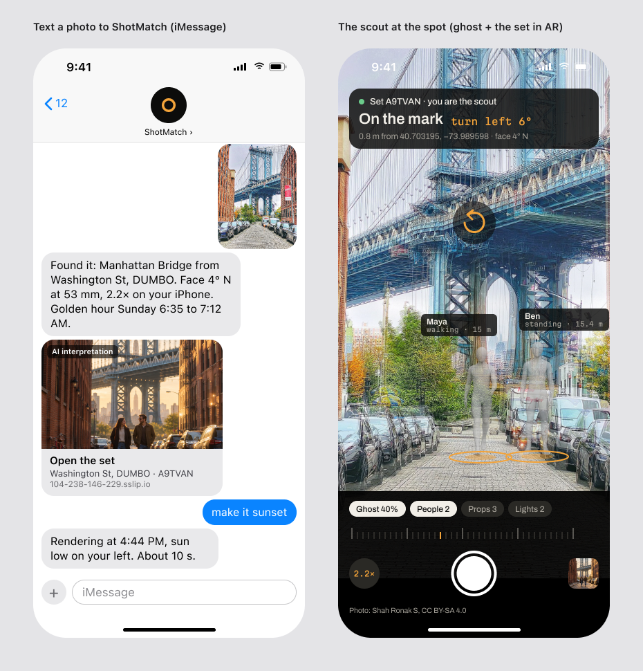
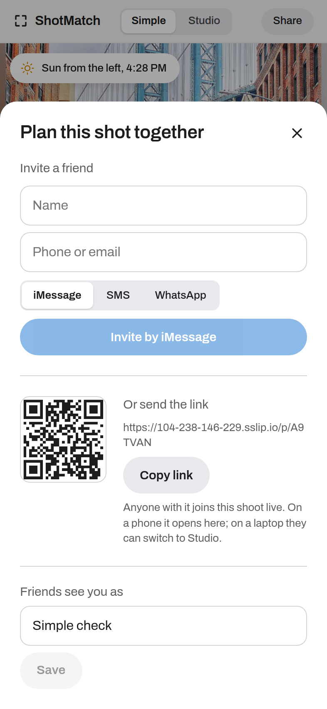

ShotMatch plans a photo shoot in a shared virtual set: a 3D copy of a real place where friends place people, props, lights and the camera, then render the shot. Photon is how the set reaches the people who are not at a laptop. Each person gets the set on the app they already use, in that app's form; a phone call guides the scout to the mark and edits the set by voice; a texted photo checks you in; a reply to an old version forks the set. The production crew went live on Photon's API and event stream at 12:30 AM CT Sunday and connected a managed Telegram bot, but no public number or bot handle is published yet (`GET /api/photon/status` lists none). The lines need numbers, DNS and testers set up by hand in Photon's dashboard, so all five mechanisms were also proven end to end against a stand-in for Photon's Beta API, with the real crew, the real SpacetimeDB module and real NVIDIA models: 29 of 29 checks.

**Best shown in:** the text threads, with the studio on screen beside them so you see the set change.

## The problem

A shoot has a photographer, two friends in the frame, someone holding a reflector and a parent who drives. Only one of them opened the studio. The scout is outdoors with a bag and maybe a tripod and can't drive a 3D editor, but can call and talk or snap one photo. Reference shots already live in Messages. And light doesn't wait: the message that matters arrives at a fixed minute, on the channel that will actually deliver.

## What ShotMatch builds for it

Five mechanisms, each starting from where the people and phones are:

1. **One live set, everyone on their own channel.** When the set changes (a render, a moved camera, a scout reaching the mark, a check-in, the call sheet), the crew sends it to each person's channel link in that channel's form. Anything anyone sends back lands in the same session.
2. **Call the set.** An ElevenLabs agent on a Photon number over SIP has two crew tools: `guide_me` gives turn-by-turn directions from the caller's live phone position and compass, and `edit_set` sends the caller's words to Nemotron's text-to-set command while planners watch. Photon's `call.ended` sends the framing and latest render to the caller's thread.
3. **Check in by photo.** The scout texts a photo; the solver places it against the spot model and the crew replies with the correction.
4. **The thread is the version tree.** Every render is a numbered version tied to a point in the set's history. Replying to a version's message (Photon's `parentMessageId`) forks the set from it.
5. **Messages at the moment of the shot.** A module schedule fires 20 minutes before golden hour; each person gets their live walking time, and refusals fall back to the next channel.

Plus: a photo of one object becomes a 3D prop in the set, and voice notes are transcribed by NVIDIA Parakeet and treated like typed messages.

## Features

| Feature | Why it is there (criterion) | Where it lives | Proof |
|---|---|---|---|
| Per-channel fan-out | Uses Photon 2.0 across channels, each in its native form | `crew/src/channels/format.ts`, `deliver.ts`, `fanout.ts` | iMessage got the image then "v1: warm golden hour light Reply to this to change it."; Telegram a 3-photo album "Lens options: 35 mm, 50 mm, 85 mm"; email one message with the image attached (`photon-e2e.ts`) |
| Invites by channel | Brings in people who will never install anything | `crew/src/channels/invite.ts`, Simple's Share sheet | "add Priya +1 469 555 0144 on SMS" from iMessage invited Priya; Telegram returned a `t.me/ShotMatchSetBot?start=<code>` link; iMessage returned "Text JOIN <code> to <line>" |
| Call the set (voice prize) | A voice call that acts on live state | `crew/src/voice.ts`, `scripts/setup-voice.ts` | `guide_me` said "Turn left 26 degrees, then walk 12 m north." from the claimed scout phone; `edit_set` moved the bike while the planner watched; `call.ended` sent the framing |
| Transcript into the set | The call is part of the shoot's record | `POST /hooks/elevenlabs` in `module/src/index.ts` | Bad signature 401; valid signature wrote 2 transcript rows; retry is a no-op |
| Check in by photo | Messaging as the scout's input | `crew/src/channels/photos.ts`, `marks.ts` | "You're 3.2 m east of the mark and facing 14 degrees too far left. 4 paces to your left, then turn right 14 degrees." and a `checkin` row at x 3.20 |
| Thread as version tree | Threaded replies drive state, not just conversation | `crew/src/channels/versions.ts`, `shot_version` in the module | A reply to v1 made v1.1 under v1, moved the bike (x 2.0 to -2.6) and came back threaded with one image |
| Golden-hour alerts with fallback | Problem codes drive delivery | `crew/src/channels/alerts.ts` | "Golden hour starts in 20 min. You're 300 m away, about 4 min on foot." on WhatsApp; Maya's iMessage refused (`SHARED_LINE_INBOUND_REQUIRED`) and it went to her email |
| Photo to prop | The camera roll becomes set pieces | `crew/src/channels/photos.ts`, `crew/src/gen.ts` | "Added a floor lamp to the set on the left, 5 m from the camera." (an earlier run hit a TRELLIS 500 and the reply said so) |
| Idempotent sends and replay cursor | A restarted crew never sends twice or misses an event | `crew/src/photon.ts`, `data/photon.json` cursor | Covered by `npm test` in `crew/` against the stand-in (50 of 50 at the Photon thread's last run) |

### Photon Beta features used

iMessage shared line (inbound text and images, replies, threaded replies), Telegram bot (direct and group chats, albums with captions, message edits, deep links), SMS outbound-first and inbound, WhatsApp Business, email on a custom domain (subject, Markdown body, attachments, inbound replies), the voice line over SIP to ElevenLabs with `call.ended`, users and spaces create-or-get, attachment upload and download, voice notes in, typing indicator, Socket.IO event delivery with a replay cursor, problem codes, idempotency keys. Not used: the dedicated iMessage line, MMS, personal WhatsApp, outbound calls and DTMF, webhooks, reactions and polls, delivery status events. The full table is in `docs/PHOTON.md`.

## Screenshots

The Figma design for the text thread and the scout phone (round 3, frame 6). This is a mockup, not a capture: the live iMessage line waits on Ben's Photon dashboard steps.

The live invite sheet in Simple. The channel choice becomes a `channel_link` row, and the crew sends the invite through Photon.

## Why Photon

The set has to reach people where they already are, on every channel at once, with each channel's native features: threaded replies on iMessage, albums and edits on Telegram, attachments on email, a voice line over SIP. Photon gives one API and one event stream for all of them, with problem codes that tell the crew when a channel refuses, so it can fall back instead of failing silently.

## Core vs track

From the ShotMatch core:
- the solver that places a check-in photo
- the set and its history in SpacetimeDB, which the version tree points into
- Nemotron's text-to-set command that `edit_set` and replies call

For the Photon track:
- the event stream, per-thread queues and router (`crew/src/photon.ts`)
- per-channel formats, invites, fan-out, alerts and fallback (`crew/src/channels/`)
- the call tools and the framing after hang-up (`crew/src/voice.ts`)
- the studio's Photon panel, channel badges and check-in markers (`web/src/photon/`)

## Known limits

- **Only Telegram is live on the real Photon project.** SMS, voice, email, WhatsApp Business and the iMessage shared line need Ben's dashboard steps (`crew/PHOTON.md`): a number with a 10DLC campaign for US SMS (review can take days), the domain's DNS for email, a SIP profile pointed at ElevenLabs for voice, testers added to the shared iMessage line.
- The proof of the five mechanisms is against `crew/test/fake-photon.ts`, a stand-in for the Beta API's HTTP routes and Socket.IO stream, not Photon's servers.
- The shared iMessage line can't message first and may refuse a late message into an open thread; invites there hand the inviter a "Text JOIN <code>" line to forward, and alerts fall back to the next channel.
- SMS gets a link instead of an image (MMS is not used).
- Hosted TRELLIS failed on image input in one run, so a photo-to-prop request can end as a flat cut-out.

## How to check it

- Photon status on the live crew: `GET https://104-238-146-229.sslip.io/api/photon/status`
- The end-to-end run (real crew, real module on the scratch database `shotmatch-photon`, real NVIDIA models, stand-in Photon and solver): `cd crew && npx tsx scripts/photon-e2e.ts`, log in `data/photon-e2e.log`
- Unit tests for formats, geometry, commands, the version tree and fallback: `cd crew && npm test`
- Write-up: `docs/PHOTON.md`; Ben's setup checklist: `crew/PHOTON.md`

## Video

**The set in your texts** (about 2:45). A screen recording of the studio beside the message threads. Beats that need a live Photon line say so; until a line is live, record `crew/scripts/photon-e2e.ts` output beside the studio and caption it as the stand-in run.

| Time | On screen | Narration | Criterion it shows |
|---|---|---|---|
| `0:00` to `0:15` | Simple `/p/A9TVAN`, then Share: the invite sheet | Most people on a shoot will never open a 3D editor. So the set comes to their texts. | Problem first |
| `0:15` to `0:45` | Studio on the test set; press Render. Telegram receives the 35, 50 and 85 mm album with the progress message edited in place. iMessage and email: record once the line is live; until then the e2e log lines for iMessage and email | One render, every channel in its own form: an album on Telegram, the image and one line on iMessage, an attachment by email. | Photon 2.0 API, multi-channel |
| `0:45` to `1:15` | Reply "make it sunset" to v1 in the thread; the studio's set rewinds to v1 and v1.1 arrives threaded. Record once iMessage is live; until then Telegram reply or the e2e log | Reply to any version and the set forks from it. The thread is a version tree over the set's history. | Threads drive state |
| `1:15` to `1:45` | Scout page on a phone at the mark; text a photo; the correction reply and a check-in marker in the studio | Text a photo from where you stand. ShotMatch solves it and tells you which way to step. | Messaging as input |
| `1:45` to `2:20` | Call the number; say "move the bike to the left"; the bike moves in the studio; hang up; the framing arrives as a text. Record once the voice number is live; until then the e2e log's `guide_me` and `edit_set` lines | Call the set. It guides you to the mark and edits the scene by voice while your friends watch. | Voice-call prize |
| `2:20` to `2:45` | The golden-hour alert on one channel and the fallback to email; then `docs/PHOTON.md` features table | Twenty minutes before golden hour, everyone gets their walking time on the channel that will deliver. | Reliability, problem codes |

Recording notes: Studio at 1512 x 982 on the left half, the phone or Telegram Desktop on the right. Use the test set ZJNNGP so renders don't pile up on A9TVAN. Prepare by running `npx tsx scripts/photon-e2e.ts` once and keeping its log open. Each live beat needs its line connected in Photon's dashboard first (`crew/PHOTON.md` steps 3 to 8).
