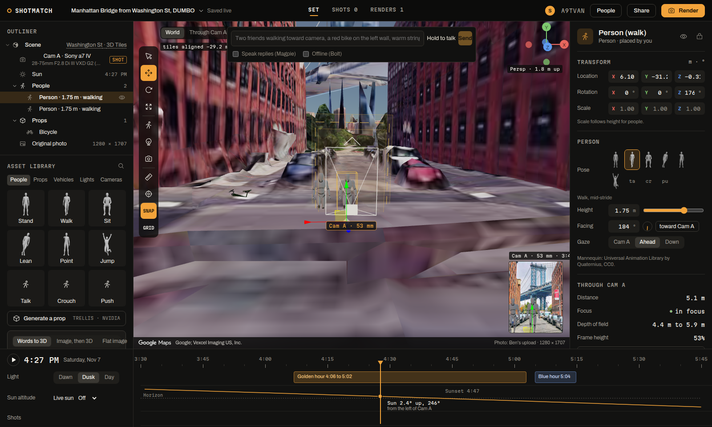

ShotMatch's primary function is a shared virtual film set: you drop a photo, ShotMatch finds where the photographer stood, and your group builds its own version of the shot in a 3D copy of the place. Every person, prop, light and camera in that set is a row in one SpacetimeDB TypeScript module on Maincloud. There is no application server between the browser and the data, no websocket layer we wrote, no queue and no cron. The planner's browser, the scout's phone, the GPU worker (the crew), the phone agent and the iMessage bridge all read and write the same rows. Without SpacetimeDB there is no set.

**Best shown in:** Studio (`/studio/A9TVAN`) with Live data open, a second browser joined by code, and the scout page on a phone.

## The problem

Planning a photo with friends today means a group chat full of screenshots. A shared 3D set needs more than a chat: a photographer drags the camera while a friend places people, a scout walks to the mark with their phone, a GPU worker solves photos and renders, and someone texts in "make it sunset". All of them must see the same set within a network round trip, edits must not collide, a crashed worker must not lose a job, and a stranger must not see a private shoot. Built the usual way, that is an API server, a websocket service, a job queue, a cron box and a permissions layer, each with its own copy of the truth.

## What ShotMatch builds for it

One module (`module/src/index.ts`, database `shotmatch`) holds all shared state, and a second database (`shotmatch-library`) holds the public library. SpacetimeDB 2.14.1 for the CLI, server SDK and client SDK; every feature was checked against the 2.14 TypeScript docs and run on Maincloud.

## Features

| Feature | Why it is there (criterion) | Where it lives | Proof |
|---|---|---|---|
| Every set object is a row | Spacetime powers the primary function: the set itself | `scene_object` table, `module/src/index.ts`; studio renders every row | 3 clients dragging their own objects at 10 Hz for 30 s: 900 of 900 committed, round trip p50 42 to 50 ms, p95 144 to 409 ms (`module/scripts/loadtest.ts`) |
| Row-level security | A shoot is private to its members | `visibility` filters (line 1598), `session_member` (line 238) | Two fresh identities on production: the outsider subscribed to every table receives 0 sessions, 0 participants, 0 objects; after joining by code, everything arrives (`proof.ts`) |
| Join by code without leaking sessions | The share code is the capability | anonymous view `session_card(code)` (line 1555), `useSessionCard` in `web/src/spacetime/hooks.ts` | The join card shows title and people online before joining; the session rows arrive only after `joinSession` |
| Gizmo locks and presence | Two people never drag one object at once | `lockSceneObject`, `presenceSweep` every 10 s (line 1287) | A frozen tab's lock is freed after 2 minutes; a drag streams `updateSceneObject` at 10 Hz and unlocks on drop |
| Scene history, undo by anyone, restore to any point | Real-time state you can trust and rewind | `scene_change` (line 288), `undoSceneChange` (905), `restoreSceneTo` (928); History scrubber in `web/src/spacetime/LiveInspector.tsx` | A drag folds into one history entry: the load test's 900 edits left 6 rows. Restores are history rows, so a restore can be undone |
| A text thread as a version tree | The iMessage thread and the set share one history | `shot_version` (378), `restoreToVersion` (1027) | Replying to v1 restores v1's snapshot as branch v1.1 (end-to-end run, `crew/scripts/photon-e2e.ts`) |
| Job leases and the sweep | A crashed worker never loses a solve | `claimJob`, `reportProgress`, `sweep` every 10 s (line 1255) | Kill the crew mid-solve: the job is requeued and finishes after restart; gives up after 3 attempts |
| Event tables | Cursors, laser pings and camera follow, never stored | `set_event` (263), `sendSetEvent` (1311), `useSetEvents` | `SELECT COUNT(*) FROM set_event` is always 0 |
| Official Rate Limit module | Fair use without our own limiter | `@spacetimedb/rate-limit` submodule (line 442) | A 12-ping burst: 7 through, 5 refused (cap 8 pings per 10 s, 40 events a second) |
| Live sun schedule | Every client's light moves together | `sun_clock`, `sunTick` every 1 s (line 1343) | 600x moved the set clock 30.0 minutes in 3.2 s |
| Procedure calling Nemotron | The database names the shoot itself | `titleSession` (line 1415) via the `title_job` schedule | NVIDIA call 121 to 126 ms ("Washington Street Bridge View") |
| Weather and alerts fetched by the database | Live conditions for active spots with no worker | `refreshLayers` procedure every 15 min (line 1503), `layer_snapshot` | Production: weather 90 ms, NWS alerts 212 ms |
| HTTP routes | Health, public share links and the phone agent's webhook | router (line 1679): `GET /health`, `GET /shot?code=`, `POST /hooks/elevenlabs` | Bad HMAC signature gets 401; a valid one writes 2 transcript rows; a retry is a no-op |
| Inter-database library | Props made in one session reach every session | `publish_prop_outbox` (327), `onPublishProp` (1395), `module/library/src/index.ts` | Real TRELLIS props ("wooden cafe chalkboard sign") went through in production: `idc publish_prop ... ok` in `spacetime logs` |

## Screenshots


The Live data panel: the feed of this session's reducer calls and row changes, the measured round trip, the history slider and the props library that arrives from `shotmatch-library` through an outbox.



Every object here is a `scene_object` row. A drag takes the lock and streams updates at 10 Hz; everyone in the set sees it move.

## Why SpacetimeDB

The set needs one source of truth that many kinds of clients edit at once and that runs logic next to the data. SpacetimeDB gives transactions, subscriptions, row-level visibility, schedules, procedures with outbound HTTP, HTTP routes and inter-database calls in one module. The guarantees we lean on come from it: a reducer is atomic, a subscription delivers every committed change in order, and an inter-database call is sent if and only if the sending transaction commits, exactly once and in order.

## Core vs track

From the ShotMatch core:
- the solver, the renders and the generated props, which the crew produces and writes back through job rows
- the studio's 3D rendering of the rows

For the SpacetimeDB track:
- every table, reducer, view, schedule, procedure and route in `module/src/index.ts`
- the `shotmatch-library` database and its outboxes
- the client pieces in `web/src/spacetime/`: presence, live sun, Live data inspector, history scrubber, shared library

## Known limits

- Row-level security is marked experimental in the docs, which recommend views. We use it because it kept every existing subscription unchanged.
- A filter can't join a table that has its own filter, so `session_member` is public: anyone can see which anonymous identities belong to which numeric session ids, but no names, codes or content.
- Event tables can't be the lookup side of a filter join, so event rows are written once per recipient.
- Clients built with older bindings fail to decode a table that gained columns; the Vultr crew crash-looped for about a minute after the first such publish, so every publish that appends a column is followed by regenerating bindings and redeploying the crew.
- HTTP routes have no path parameters (`/shot?code=`), and TypeScript query builders don't take view arguments.
- Recreating a receiving database under the same name strands pending calls from senders that used the old one; we retired the affected scratch database.
- The track requires a public repo. The repo becomes public after Ben's secrets scan.

## How to check it

- Health route: https://maincloud.spacetimedb.com/v1/database/shotmatch/route/health
- From `module/`:

```sh
npm run check                                   # SHA-256/HMAC against node:crypto
node scripts/proof.ts shotmatch-scratch         # every feature, two users plus a crew (scratch database): 38 of 38
node scripts/proof.ts shotmatch                 # production: filters, views, presence, events, history, HTTP: 19 of 19
node scripts/loadtest.ts shotmatch 3 10 30      # the load test above
scripts/demo.sh shotmatch                       # live SQL over both databases, HTTP routes, log highlights
```

- In the app: open `/studio/A9TVAN`, press Live. The Feed streams reducer calls as people edit; History scrubs and restores the set.
- Full write-up with line links: `docs/SPACETIME.md`.

## Video

**The set is the database** (about 2:30). A screen recording of two browsers and a phone-sized window on one set, with the Live data panel showing every change as it arrives.

| Time | On screen | Narration | Criterion it shows |
|---|---|---|---|
| `0:00` to `0:15` | Simple `/p/A9TVAN`: the photo snapped onto the 3D view | You found where the photo was taken. Now your whole group builds the shot in one live set. | Problem first |
| `0:15` to `0:40` | Browser 2 (fresh profile) opens `/studio/A9TVAN`: the join card, then Join; both windows side by side, presence chips appear | Before joining, a stranger sees only the card. Row-level security sends a shoot's rows only to its members. | Security, primary function |
| `0:40` to `1:05` | Browser 1 drags a person with the gizmo; browser 2 sees it move, the other person's lock tag shows; laser ping "pointing here" | Every person, prop, light and camera is a row. Drags stream at ten a second. Pings are event rows, never stored. | Real-time sync |
| `1:05` to `1:25` | Open Live data: the Feed streaming reducer calls, changes per second, round trip | No server of ours in between. This is the module's own stream of calls and row changes. | SpacetimeDB as the backend |
| `1:25` to `1:45` | History tab: scrub back, ghost preview, Restore; then undo the restore | Anyone can undo anyone's change, or rewind the whole set and restore it. | Scene history |
| `1:45` to `2:05` | Timeline: Live sun at 600x; the light sweeps in both windows | A schedule in the database runs the sun, so every client's light moves together. | Schedules |
| `2:05` to `2:30` | Terminal: `node scripts/loadtest.ts shotmatch 3 10 30` result, then `scripts/demo.sh shotmatch` SQL and the health route | Load test: 900 of 900 edits committed, median round trip one network hop. | Proof |

Recording notes: two Chrome profiles at 1280 x 800 side by side, or one display of 2560 wide. Use A9TVAN for viewing and ZJNNGP for edits that should not stay in the demo set. Run the load test before recording and paste its output if the venue network is slow. The job reclaim (kill the crew mid-solve) needs ssh to the VM: `systemctl --user restart shotmatch-crew` during a solve, then show the toast "job reclaimed".
