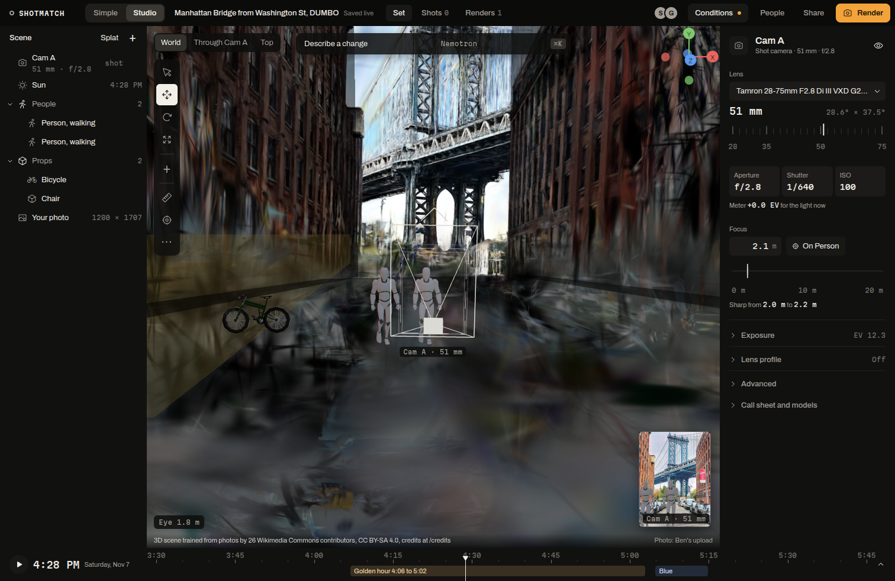
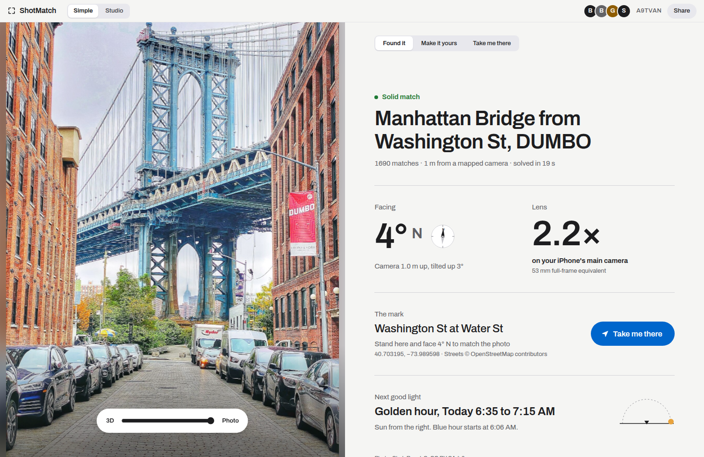

ShotMatch's production runs on Vultr. One VM in Dallas serves the app over HTTPS and runs the crew (the worker that solves photos, calls the models and bridges messages), the solver and Ollama with Nemotron 3.5 Bolt for the offline path. Vultr Object Storage keeps photos, previews and generated props. Vultr Serverless Inference runs four of the models in the pipeline, including Nemotron Content Safety, which screens every upload and command. This documentation site is served from the same VM.

**Best shown in:** the live app at https://104-238-146-229.sslip.io and this site, both from the VM `shotmatch-app`.

## The problem

ShotMatch needs a public HTTPS address for phones (iOS needs HTTPS before the scout page can use the camera and motion sensors), a box that runs a Python solver, a Node worker and a local model side by side, storage for photos that every member of a shoot can load, and hosted models for safety, image edits and speech. Spreading that across a laptop, a home server and several AI vendors means more keys, more outages and more places a user's photo travels.

## What ShotMatch builds for it

- **The VM `shotmatch-app`** in Vultr's Dallas region (DFW): 12 vCPUs, 24 GB of memory, Ubuntu 24.04.5. It runs four user services: `shotmatch-crew` (Node, port 8790), `shotmatch-solver` (Python FastAPI, localhost only, port 8791), `shotmatch-ollama` (Nemotron 3.5 Bolt E4B on the CPU) and `shotmatch-lens-tunnel` (an ssh tunnel to the GPU box that serves our fine-tuned lens model).
- **Caddy** in front with automatic HTTPS certificates: one site block for the app and one for this site (`ops/Caddyfile`).
- **Vultr Object Storage** through its S3 API: photos, previews and generated props. The crew makes four S3 calls and signs them itself (SigV4) instead of pulling in the AWS SDK (`crew/src/s3.ts`). The crew keeps working from disk if the bucket is unreachable.
- **Vultr Serverless Inference** (OpenAI-compatible, `crew/src/config.ts`): Nemotron 3.5 Content Safety (primary safety path), Nemotron 3 Nano Omni (second physics check and speech fallback), Qwen-Image 2.1 (the render generator while FLUX is down) and Whisper large v3 turbo (last speech fallback).

## Features

| Feature | Why it is there (criterion) | Where it lives | Proof |
|---|---|---|---|
| Production VM | The whole app runs on Vultr compute | `ops/shotmatch-*.service`, `ops/deploy-vultr.sh` | Serves https://104-238-146-229.sslip.io; the SpacetimeDB load test from this VM committed 900 of 900 edits, round trip p50 50 ms |
| Offline model on the VM's CPU | Inference with no GPU and no hosted API | `ops/ollama.sh`, `shotmatch-ollama` | Bolt routes a command in 1.67 s; a full offline set command ran in 30.8 s (prompt processing about 44 tokens a second) |
| Safety on Vultr Serverless Inference | Every input screened, on the same cloud as the app | `crew/src/models.ts` | Nemotron Content Safety 0.51 s on text, 1.9 s with an image. NVIDIA's copy of the same id returns 404 for our key, so Vultr is the primary path |
| Second physics opinion | A second model checks each render | `crew/src/render.ts` | Nano Omni answered in 1.2 s with reasoning off |
| Render generator | The AI render pass keeps working while FLUX is down | `crew/src/models.ts` (`vultrEdit`) | The physics-checked render run took 29 s end to end with Qwen-Image 2.1 as the generator |
| Object Storage | Photos and props every member can load, off the VM's disk | `crew/src/s3.ts`, `crew/scripts/bucket-sync.ts` | Configured on the VM (`vultr_s3`); throughput not measured |
| The photoreal set, served | A 27.6 MB Gaussian splat streams to every studio | crew route `/splat/<spot>.<ext>` on the VM | https://104-238-146-229.sslip.io/splat/nyc_dumbo_lite.compressed.ply (1.69 M Gaussians) |
| This site | Docs and track pages on the same box | Caddy site block, `site/dist` | https://site.104-238-146-229.sslip.io |

## Screenshots

The DUMBO splat streaming from the VM into Studio on the production URL.

Simple, served by Caddy and the crew on the Vultr VM.

## Why Vultr

One provider gives us the public box, the storage and hosted models that matter to the pipeline. Content Safety only answers for our key on Vultr, and Qwen-Image on Vultr is what keeps the render pass running while NVIDIA's FLUX endpoint fails. The VM's 12 vCPUs run the CPU solver and a local Nemotron next to the crew, so the offline path needs no other machine.

## Core vs track

From the ShotMatch core:
- the crew, the solver and the web app that run on the VM
- the models' roles in the pipeline (`docs/NVIDIA.md`)

For the Vultr track:
- the VM, its services and Caddy
- Object Storage for photos, previews and props
- Serverless Inference for safety, the second physics check, the render generator and speech fallback

## Known limits

- **No Vultr GPU.** The first create of an A40 instance (`vcg-a40-24c-120g-48vram`, about $1.71 an hour) failed with "Your account does not have any additional credit". After credit was added, the second failed at 8:04 PM CT Saturday: "You have reached the maximum monthly fee limit for this account". The account cap is $250 a month per instance, so even an A16 was refused; a limit-increase request for $1,500 went to Vultr's team, which works weekdays. The fine-tune and the splat ran on a Brev A100 from the HackUTD NVIDIA credit instead, and the VM reaches it through `shotmatch-lens-tunnel`. Vultr GPU spend stayed $0.
- The solver runs on CPU: 11.0 to 18.5 s a photo on linuxbox. Its time on the VM was not measured separately.
- Object Storage throughput and latency were not measured.

## How to check it

- The app: https://104-238-146-229.sslip.io; this site: https://site.104-238-146-229.sslip.io
- The services, over ssh to the VM: `systemctl --user status shotmatch-crew shotmatch-solver shotmatch-ollama shotmatch-lens-tunnel`
- The model ledger, which names Vultr Serverless Inference and Ollama on the VM per model: `GET https://104-238-146-229.sslip.io/api/nvidia/models`
- Deploy: `ops/deploy-vultr.sh` from linuxbox (rsync of the checkout, then a crew restart); GPU cost log in `lens/COST.md`

## Video

**ShotMatch on Vultr** (about 1:30). A screen recording of the live app, then a terminal on the VM.

| Time | On screen | Narration | Criterion it shows |
|---|---|---|---|
| `0:00` to `0:15` | Simple `/p/A9TVAN` on the production URL: the answer for the DUMBO photo | ShotMatch tells you where to stand for a photo you saw. All of it runs on Vultr. | Problem first |
| `0:15` to `0:35` | Terminal: `ssh ben@104.238.146.229 'systemctl --user status shotmatch-*'`: crew, solver, Ollama, lens tunnel active | One VM in Dallas: the crew, the solver and Nemotron Bolt on the CPU, behind Caddy with automatic HTTPS. | Vultr compute |
| `0:35` to `0:50` | Browser: the app at `104-238-146-229.sslip.io` and this site at `site.104-238-146-229.sslip.io`, the padlock on both | Two hostnames, one Caddy, certificates issued automatically. | Hosting |
| `0:50` to `1:10` | Studio: drop a photo in a test set; the agent trace shows the safety check; then `GET /api/nvidia/models` with the Vultr rows highlighted | Every upload is screened by Nemotron Content Safety on Vultr Serverless Inference, in about half a second. | Vultr Serverless Inference |
| `1:10` to `1:30` | Studio: tick Offline (Bolt), send "add a park bench on the right"; the bench appears | When the hosted API is down, Nemotron runs on the VM's own CPU. | Edge inference on Vultr |

Recording notes: use a test session, not A9TVAN, for uploads and edits. The offline command takes about 30 seconds; cut the wait. Mask the IP-based hostnames only if a real domain is live by recording time (`ops/DOMAIN.md`).
